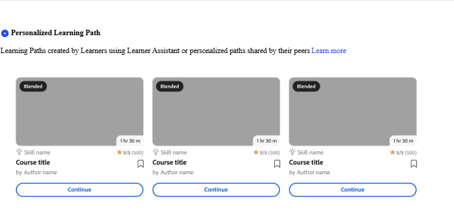

# Marca de administrador: reposicionamiento de la página principal PLP y VC strips

## Adición y reordenación de tiras de página de inicio en Adobe Learning Manager

Añada rutas de aprendizaje personalizadas y tiras de instructor virtual a la página de inicio del alumno, y arrastre y suelte tiras para establecer el orden en que ven los alumnos.

Como administrador, puede añadir rutas de aprendizaje personalizadas (PLP) y tiras de orientación virtual a la página de inicio del alumno en Adobe Learning Manager. También puedes reordenar todas las tiras de la página de inicio con controles de arrastrar y soltar en **Admin Branding**. Ahora puede decidir qué tiras ven primero los alumnos.

También puede añadir un widget de ruta de aprendizaje personalizada a una página personalizada.

### Acerca de las tiras de página principal

Las tiras de la página de inicio son los widgets (tarjetas) que aparecen en la página de inicio del alumno. En Marca de administrador, puede controlar qué tiras aparecen y el orden en el que aparecen. En la versión de diciembre de 2026 de ALM, hay dos tiras con tecnología de IA disponibles:

* **Tira de rutas de aprendizaje personalizadas:** Resalta las rutas de aprendizaje generadas por IA para cada alumno.
* **Tira de entrenamiento virtual:** Ayuda a los alumnos a encontrar y abrir experiencias de entrenamiento desde la página de inicio.

### Tira personalizada de rutas de aprendizaje

Los alumnos pueden utilizar la tira para:

* Accede a rutas de aprendizaje generadas por IA.
* Continuar las rutas de aprendizaje generadas anteriormente.
* Descubre los recorridos de aprendizaje recomendados.

### Tira de entrenador virtual

Los alumnos pueden utilizar la tira para:

* Descubre las experiencias de Virtual Coach.
* Reanuda las actividades de coaching.
* Empieza a enseñar inteligencia artificial conversacional desde la página de inicio.

### Reordenar tiras de página principal

Puede colocar cualquier tira en cualquier posición. Por ejemplo, puede mostrar primero la tira de Entrenador virtual, seguida de las rutas de aprendizaje personalizadas, las tiras **Recomendado** y **Catálogo** y, a continuación, **Visto recientemente**.

1. En la aplicación del administrador, seleccione **Configurar** > **Marca** en el panel de navegación izquierdo.

   

2. Seleccione **Página de inicio del alumno**.
3. En la lista de tiras, localice la tira que desea mover.
4. Arrastre la banda a su nueva posición.

   

5. Guarde los cambios.

Después de publicar, el nuevo orden aparece en la página de inicio del alumno.

>[!NOTE]
>
>Si la tira de Ruta de aprendizaje personalizada o Entrenador virtual no está en la lista, asegúrese de que se ha añadido a la configuración de la página de inicio antes de reordenar.

## Añadir un widget de ruta de aprendizaje personalizado a una página personalizada

Puede utilizar el widget Ruta de aprendizaje personalizada fuera de la página de inicio. Agréguelo a una página personalizada para que los alumnos tengan un lugar específico en el que encontrar recomendaciones de aprendizaje personalizadas.

1. Seleccione **Páginas personalizadas**.
2. Cree una página o edite una página existente.
3. Agregue un widget de **Ruta de aprendizaje personalizada**.

   

   Revise el widget.

   

4. Seleccione **Continuar**.
5. Añada el título y la descripción del widget.

   

6. Seleccione **Agregar widget**.
7. Guarde la página.
8. Publish abre la página.
