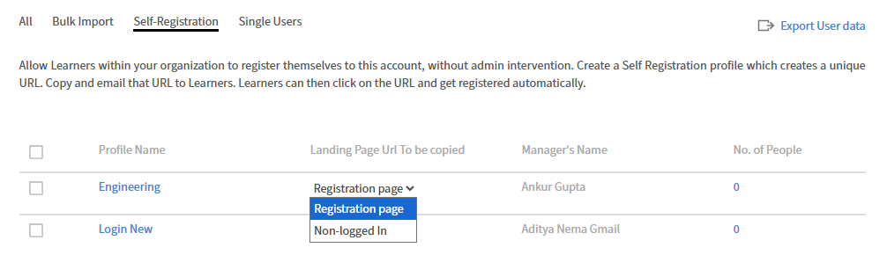

# Usar una URL de menú que no haya iniciado sesión para el registro automático

Los perfiles de registro automático permiten a los usuarios externos, como socios o miembros de varias organizaciones, crear sus propias cuentas en Adobe Learning Manager. Ahora puede compartir una dirección URL de menú que no haya iniciado sesión para cada perfil de registro automático. El menú está integrado en Experience Builder.

Cuando los usuarios seleccionan **Registrarse** en una página a la que se accede a través de esa dirección URL, Adobe Learning Manager los agrega al perfil al que pertenece la dirección URL. Esto le permite mantener a los usuarios de diferentes organizaciones, como diferentes agencias o empresas asociadas, en perfiles independientes.

Anteriormente, una dirección URL de página sin sesión siempre agregaba nuevos usuarios al perfil seleccionado en **Marca**. La URL de menú que no ha iniciado sesión elimina esta limitación: cada perfil tiene su propia URL y todas las URL abren la misma página de destino.

## Antes de comenzar

1. Cree el menú sin iniciar sesión en Experience Builder y seleccione la página de aterrizaje en **Marca**. Todas las URL de perfil abren esta página de aterrizaje.

1. Cree el perfil de registro automático en **Usuarios** > **Externo**. Cada perfil tiene su propio ID de grupo y su clave de acceso, que los usuarios deben registrar.

## Copiar la URL de registro de un perfil

1. Seleccione **Usuarios** > **Externos** y, a continuación, seleccione **Registro automático**.

1. En la columna **URL de la página de destino que se va a copiar**, seleccione **No registrado** para un perfil.

   

1. Copie la URL y compártala con los usuarios que desee invitar.

La lista **URL de la página de destino que se va a copiar** incluye estas opciones:

* **Registro**: La URL de registro estándar
* **Página de inicio no registrada (heredada)**: La dirección URL de la página de inicio heredada sin inicio de sesión
* **Menú no registrado**: La dirección URL del menú sin iniciar sesión en Experience Builder

## Lo que ven los usuarios

1. El usuario abre la dirección URL y aterriza en la página de destino que no inició sesión seleccionada en **Marca**.

1. El usuario selecciona **Registrarse** e introduce el ID de grupo y la clave de acceso para el perfil.

1. El usuario introduce su nombre, dirección de correo electrónico y contraseña y, a continuación, completa el registro.

Adobe Learning Manager añade al usuario al perfil al que pertenece la dirección URL. Puede ver el nuevo usuario bajo ese perfil en **Usuarios** > **Externo**.

>[!NOTE]
>
>Cada URL de perfil muestra la misma página de destino. Solo difiere el perfil al que se agregan los usuarios.

## Enviar un correo electrónico de bienvenida con la URL

1. Seleccione **Usuarios** > **Externos** y elija el perfil de registro automático.

1. En la lista **URL de la página de destino que se va a copiar**, seleccione la URL que desea incluir en el correo electrónico.

   

1. Seleccione el icono de correo electrónico para enviar el correo electrónico. También puede seleccionar el icono de copia para copiar la URL.

Adobe Learning Manager envía el correo electrónico utilizando la plantilla **Perfil creado (externo/socios)**. El correo electrónico contiene la dirección URL exclusiva que ha seleccionado, el límite de puestos para el perfil y la fecha de caducidad de la dirección URL. Comparta la URL con los usuarios que desee invitar.

## Desplazarse desde la página de inicio heredada sin iniciar sesión

Las versiones anteriores de esta lista mostraban la opción **No registrado**. Ahora se llama **No registrado en la página de inicio (heredada)**.

La página de inicio heredada sin inicio de sesión quedará obsoleta en una futura versión. Si lo utiliza, vaya al menú sin sesión de Experience Builder para conservar la misma funcionalidad.
