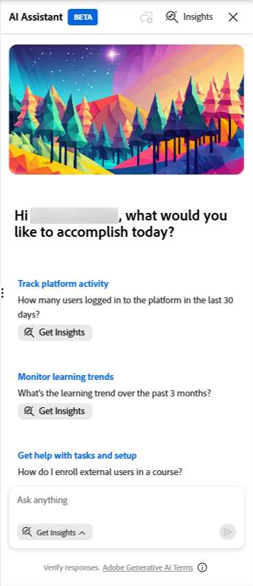
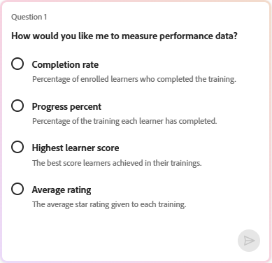
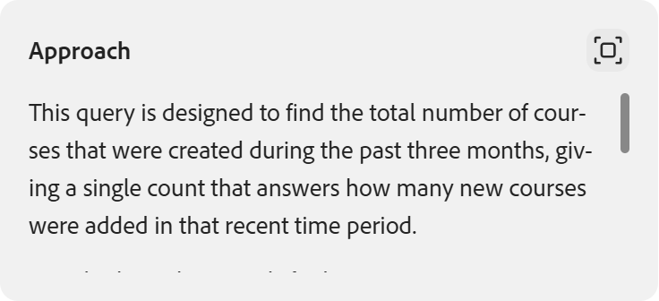
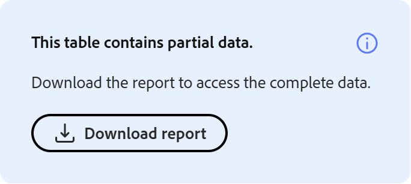
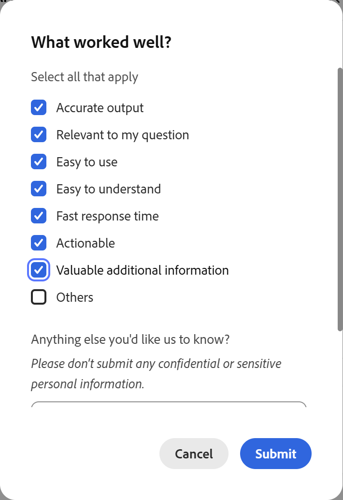
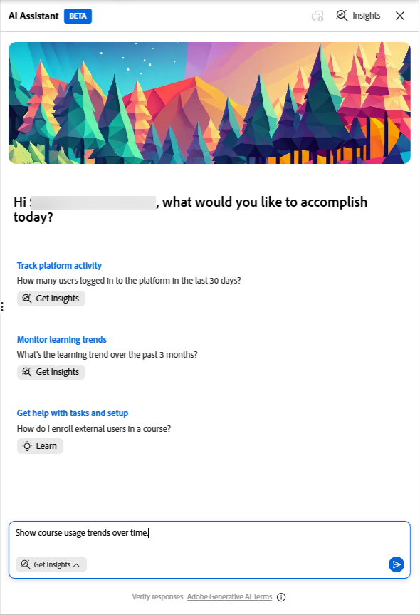
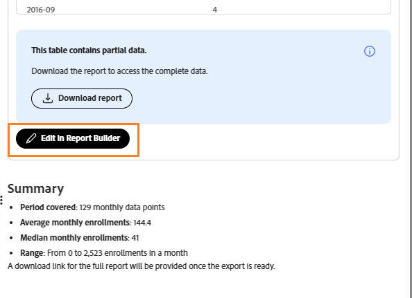
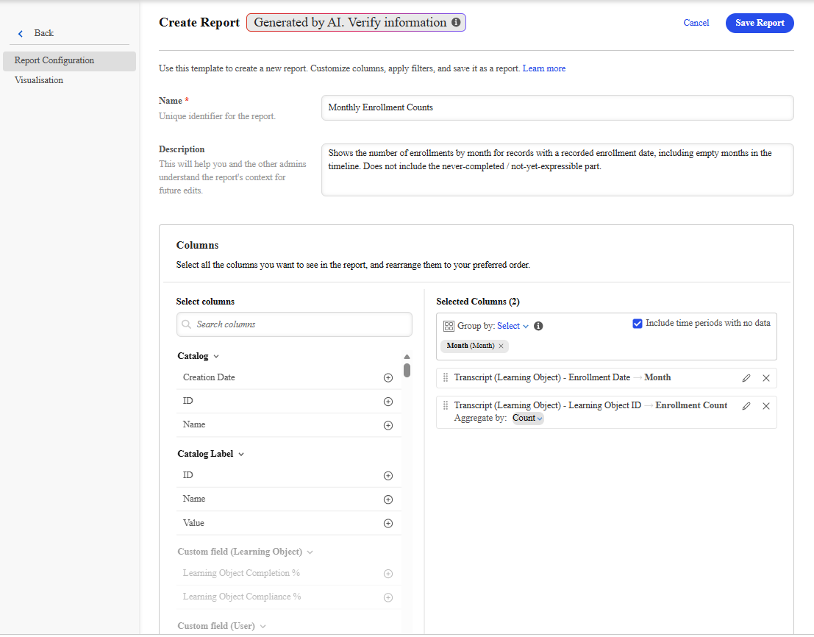

# ¿Qué es Insights Agent?

Insights Agent es una función impulsada por IA de Adobe Learning Manager que permite a los administradores consultar datos de aprendizaje mediante lenguaje natural. En lugar de descargar informes y manipular hojas de cálculo, escriba una pregunta, como &quot;¿Cuántos cursos se han creado en los últimos 3 meses en la cuenta? Dame un informe mensual&quot;, y Insights Agent recupera y presenta los datos directamente. Puede ver los resultados como texto, viñetas o tablas, o descargarlos como un archivo CSV.

Insights Agent está diseñado para reducir los pasos entre tener una pregunta de datos y obtener una respuesta. Los administradores que actualmente dependen de tablas dinámicas de Excel, equipos de IE o varios informes combinados pueden utilizar Insights Agent para obtener respuestas más rápido.

## Qué puede hacer Insights Agent

Puede utilizar Insights Agent para:

* Comprobar las métricas de finalización y cumplimiento normativo por región, departamento o grupo de usuarios
* Analizar tendencias de inscripción en cursos o rutas de aprendizaje
* Ver datos de progreso de un curso o ruta de aprendizaje específicos

Cada consulta devuelve una tabla con formato o un archivo CSV descargable, junto con una explicación en lenguaje sencillo de cómo se calcularon los resultados.

## Qué datos no admite Insights Agent

Los siguientes tipos de datos están fuera del ámbito de Insights Agent actualmente:

* Comentarios y datos de la encuesta
* Puntos e insignias de interacción
* Historial de auditoría y registros de cambios

Las consultas que hacen referencia a estos tipos de datos no devuelven resultados. Por ejemplo, &quot;¿Cuántos puntos de interacción se otorgaron el último trimestre?&quot; o &quot;¿Qué alumnos han obtenido una insignia de cumplimiento?&quot; devolverá un error o datos incompletos.

## Cómo funciona Insights Agent

Al introducir una pregunta, Insights Agent la procesa en cuatro etapas:

1. **Interpretación**: El agente analiza su pregunta para identificar qué datos se necesitan. Si alguna parte de la pregunta es ambigua, el agente le hace una pregunta aclaratoria antes de continuar

2. **Método**: El agente describe los pasos que tomó para encontrar su respuesta. Esta sección le ayuda a comprobar que los datos se recuperaron de la forma prevista, especialmente para consultas complejas.

3. **Resultados**: El agente presenta los datos como texto, viñetas o una tabla en función de la naturaleza de los resultados. Con los resultados se incluye un resumen en lenguaje sencillo. Cuando los resultados contienen 50 filas o menos, el resumen incluye información analítica sobre los datos. Cuando los resultados contienen más de 50 filas, el resumen proporciona estadísticas de nivel de columna.

4. **Descargar**: Puede descargar los resultados como un archivo CSV. Los informes de gran tamaño pueden tardar más tiempo; el agente le notifica cuando el archivo está listo.

La sección **Approach** es especialmente útil para consultas complejas. Muestra la lógica utilizada por el agente, similar a la que explicaría un analista de BI si ejecutara la consulta manualmente. La revisión del enfoque le ayuda a confirmar que el resultado es fiable antes de actuar en consecuencia.

## Hacer preguntas con Insights Agent

Utilice Insights Agent en Adobe Learning Manager para consultar datos de aprendizaje con preguntas en un lenguaje sencillo y obtener resultados como texto, tablas o archivos CSV descargables.

Insights Agent está disponible para los administradores en el panel de asistentes de IA en Learning Manager. El panel es redimensionable. Puede expandirlo para facilitar la lectura de los resultados. De forma predeterminada, el modo **Obtener información** está seleccionado al abrir el panel. También hay disponible un modo de **aprendizaje** independiente para preguntas de instrucciones sobre cómo usar el producto. El modo **Aprender** responde preguntas instructivas sobre cómo usar Learning Manager. Por ejemplo, &quot;¿Cómo puedo crear una ruta de aprendizaje?&quot; No consulta datos de alumnos. [Más información](/help/migrated/administrators/feature-summary/insights-agent.md#create-report-insights-agent)

### Haz una pregunta

Cuando el modo **Obtener información** está seleccionado de forma predeterminada, puedes empezar inmediatamente a consultar los datos de aprendizaje sin necesidad de ajustar el modo cada vez que accedas al asistente. Sin embargo, si alguna vez cambias al modo **Aprendizaje** para preguntas instructivas, asegúrate de volver a seleccionar **Obtener información** antes de enviar una consulta.

1. Seleccione el icono de asistente de AI en Learning Manager para abrir el panel de asistentes. La opción **Obtener información** ya está seleccionada de forma predeterminada.

   

2. Escriba su pregunta en el campo de texto. Use un lenguaje sencillo. Por ejemplo: **¿Cuántos cursos se han creado en los últimos 3 meses?**

3. Selecciona **Enviar** o pulsa **Entrar** para enviar tu pregunta.

### Revisar la respuesta

Después de enviar la pregunta, Insights Agent procesa la solicitud y devuelve una respuesta con hasta cuatro partes:

1. **Desambiguación (si es necesario):** Si la pregunta contiene un término ambiguo, como &quot;actividad de aprendizaje&quot; o &quot;rendimiento&quot;, o &quot;Proporcionarme datos de rendimiento de los últimos tres meses&quot;, el asistente muestra una lista de opciones y le pide que seleccione una antes de continuar. Seleccione la opción que mejor se adapte a lo que está buscando. Después de la pregunta inicial, no puede escribir instrucciones adicionales. La selección de una de las opciones proporcionadas es la única interacción disponible hasta que se inicia una nueva consulta mediante la interfaz de consulta. Solo puede responder a la desambiguación seleccionando una de las opciones proporcionadas; el seguimiento de texto libre no está disponible en esta versión.

   

2. **Método:** En la sección **Método** se describen los pasos que el agente ha seguido para recuperar los datos. Aparece como un panel desplazable debajo de la pregunta. Seleccione el icono de expansión para ver la aproximación completa. Si revisa esta sección, podrá confirmar que la lógica coincide con sus intenciones, especialmente para consultas complejas. Por ejemplo, si solicita &quot;todos los alumnos inscritos en el último año&quot;, el agente puede devolver la inscripción más reciente de cada alumno en lugar de todos los registros de inscripción. La sección **Método** explica las decisiones que tomó el agente al recuperar los datos. Si la lógica no coincide con su intención, inicie una nueva consulta con términos más específicos.

   

3. **Resultados:** Insights Agent genera resultados como texto o tabla. Para los puntos de datos que se interpretan mejor en formato tabular, Insights Agent devuelve una tabla. Insights Agent no genera tablas ni gráficos. Para visualizar los datos, descargue el archivo CSV y ábralo en su herramienta preferida. Con los resultados se incluye un resumen en lenguaje sencillo. Cuando los resultados contienen 50 filas o menos, el resumen incluye información analítica sobre los datos. Cuando los resultados contienen más de 50 filas, el resumen proporciona estadísticas de nivel de columna. Por ejemplo, &quot;¿Qué cursos no tienen menos de 5 inscripciones que se hayan creado en el último año y quiénes son los autores?&quot;

   

Y la respuesta contiene el siguiente resumen:

***Resumen***

- *Cursos coincidentes: 102*
- *Intervalo de recuento de inscripciones: del 24 al 2019*
- *Promedio de inscripciones por curso coincidente: 589,6*
- *Inscripciones medias por curso coincidente: 553,5*

*Cuando la exportación esté lista, se proporcionará un vínculo de descarga para el informe completo.*

>[!NOTE]
>
>El formato del resumen varía en función de la naturaleza de los datos. A continuación se muestra un ejemplo de una respuesta de resumen. El resumen real variará en función de la consulta.

>[!NOTE]
>
>Insights Agent es probabilístico. Si ejecuta la misma consulta dos veces, la formulación de la respuesta o el orden de los resultados pueden variar ligeramente.

### Descargar el informe

Selecciona **Descargar informe** para exportar los resultados como archivo CSV. En el caso de conjuntos de resultados grandes, la descarga puede tardar más tiempo. El agente muestra un mensaje cuando el archivo está listo; también recibirá una notificación.

## Iniciar una nueva consulta

Cada sesión de Insights Agent gestiona una pregunta a la vez. Después de revisar los resultados, selecciona **Nueva pregunta** para hacer una pregunta diferente. También puedes seleccionar **Nuevo chat** en cualquier momento, incluso antes de recibir una respuesta, si deseas abandonar la consulta actual y comenzar de nuevo. No se puede escribir una pregunta de seguimiento en la misma sesión ni pedir al agente que perfeccione o amplíe los resultados devueltos.

>[!TIP]
>
>Si desea explorar datos relacionados, inicie una nueva consulta que incorpore lo aprendido en la primera. Por ejemplo, después de ver los totales de inscripción por región, inicie una nueva consulta para profundizar en las regiones de menor rendimiento.

## Proporcionar comentarios

Después de cada respuesta, seleccione el icono de miniaturas hacia arriba o hacia abajo para valorar el resultado. También puede especificar si el resultado fue inexacto, difícil de entender o tardó demasiado en devolverse. Estos comentarios ayudan a mejorar el agente con el tiempo.

## Prácticas recomendadas

- Empiece con una pregunta específica en lugar de una pregunta amplia. &quot;¿Cuál es la tasa de finalización del curso de formación sobre seguridad en el grupo de usuarios de Norteamérica?&quot; devuelve resultados más útiles que \&quot;Mostrar datos de finalización.&quot;
- Utilice términos exactos de Adobe Learning Manager al asignar nombres a contenido y grupos de alumnos. La guía de escritura de consultas enumera los términos correctos que se deben utilizar.
- Si el agente hace una pregunta aclaratoria, trátela como una señal para perfeccionar su consulta original la próxima vez. Cuanto más específica sea tu pregunta, menos aclaraciones serán necesarias.
- Revise la sección **Método** antes de actuar sobre los resultados para confirmar que la lógica del agente coincide con su intención.
- **Especifique si desea incluir alumnos en lista de espera.** De forma predeterminada, las consultas de recuento de inscripciones devuelven solo a los alumnos con una inscripción activa y confirmada. Se excluyen los alumnos en lista de espera, de forma coherente con la lista de alumnos inscritos disponible en el curso o la página de ruta de aprendizaje. Si desea incluir alumnos en lista de espera en el recuento, dígalo explícitamente en la consulta. Por ejemplo: &quot;¿Cuántos alumnos se inscriben directamente en el curso de formación sobre seguridad, incluidos los que están en lista de espera?&quot; La sección Enfoque indicará si los alumnos en lista de espera se incluyeron en los resultados.
<!--
- **Specify whether to include or exclude waitlisted learners**. By default, enrollment count queries include learners who are on a waitlist alongside active, confirmed enrollments. If you need only active participants, explicitly exclude waitlisted learners in your query. For example: "How many learners are directly enrolled in the Safety Training course, excluding waitlisted learners?" The agent will disclose in the Approach section that the exclusion was applied. Without this instruction, enrollment totals may include a significant proportion of waitlisted learners who have not yet started the content.
-->
- **Recuentos de inscripción directa e indirecta**: Al consultar los datos de inscripción o finalización de un curso o una ruta de aprendizaje, Insights Agent distingue entre inscripciones directas (alumnos inscritos específicamente en ese curso o ruta de aprendizaje) e inscripciones indirectas (alumnos que accedieron al mismo contenido como parte de una ruta de aprendizaje o certificación). Si solicita específicamente inscripciones directas o indirectas, el agente devuelve el recuento correcto para cada tipo. Si la consulta no especifica directa o indirectamente, el agente puede devolver un recuento combinado. Para obtener recuentos separados, incluya la distinción explícitamente en la consulta. Por ejemplo: &quot;¿Cuántos alumnos están inscritos directamente o indirectamente en el curso de formación sobre seguridad?&quot;

## Diferencia entre Insights Agent y Report Builder

Ambas funciones utilizan los mismos datos de aprendizaje subyacentes, pero funcionan de forma diferente. Insights Agent es conversacional. Usted describe lo que desea y el agente lo recupera. El Report Builder está estructurado. Puede seleccionar conjuntos de datos, columnas y filtros para generar informes reutilizables.

| **Caso de uso** | **Recomendación** |
|---|---|
| Haz una pregunta rápida sobre los datos | Agente de información |
| Explorar datos sin conocer el esquema | Agente de información |
| Crear un informe estructurado y repetible | Generador de informes |
| Combinar varios conjuntos de datos con uniones personalizadas | Generador de informes |
| Programar suscripciones de informes | Generador de informes |
| Combinar conjuntos de datos con uniones personalizadas o modelado de datos avanzado | Generador de informes |

## Escribir consultas eficaces para Insights Agent

La calidad de la consulta afecta directamente a la calidad de los resultados que devuelve Insights Agent. Una consulta bien formada incluye tres ingredientes: contexto, por ejemplo, qué contenido y qué alumnos, ámbito, por ejemplo, estado, intervalo de tiempo y estado de usuario, y columnas, por ejemplo, los campos exactos que desea en la salida. Aprenda a utilizar la terminología, la estructura de consulta y las consultas de ejemplo correctas como puntos de partida.

### La fórmula de consulta de tres partes

Cada consulta eficaz de Insights Agent contiene estos tres componentes:

| **Componente** | **Qué podría significar** | **Ejemplo** |
|---|---|---|
| **Contexto** | El contenido y los alumnos sobre los que pregunta | &quot;...la ruta de aprendizaje de incorporación de nuevos empleados para alumnos de Sales Associate en la ubicación 101...&quot; |
| **Ámbito** | Estado de inscripción, intervalo de tiempo y estado del usuario | &quot;...que se hayan inscrito pero aún no se hayan completado, en los últimos 90 días...&quot; |
| **Columnas** | Todos los campos que desee incluir en la salida | &quot;...mostrar nombre, correo electrónico, ubicación y fecha de inscripción&quot; |

La ausencia de cualquiera de estos componentes puede dar lugar a resultados ambiguos o a una pregunta aclaratoria del agente.

### Utilizar los términos de ALM correctos

Insights Agent compara su consulta con el modelo de datos de Adobe Learning Manager. El uso de un término incorrecto puede devolver resultados incorrectos o ningún resultado. Utilice los términos de la columna de la izquierda a continuación.

| **Usar este término** | **No este** |
|---|---|
| **Ruta de aprendizaje** | Programa / seguimiento / plan de estudios |
| **Curso** | Módulo / clase / lección |
| **Certificación** | Insignia/certificado |
| **Alumno** | Estudiante/empleado |
| **Sesión** | Clase / fecha programada |
| **Grupo de usuarios** | Equipo / departamento / cohorte |
| **Campo activo** | Campo/atributo personalizado |
| **Inscripción** | Registro / asignación |
| **Finalización** | Terminado / terminado / pasado |
| **Etiqueta de catálogo** | Categoría/grupo de etiquetas |

Insights Agent no distingue entre mayúsculas y minúsculas, pero la coincidencia exacta de términos mejora la precisión.

### Realizar consultas utilizando la terminología personalizada de su organización

Si el administrador ha cambiado el nombre de las condiciones estándar mediante la terminología del producto en **Configuración > General**, Insights Agent reconoce las condiciones personalizadas de su organización en lugar de las condiciones predeterminadas que se indican anteriormente. Por ejemplo, si tu organización cambió el nombre de **Curso** a **Capítulo**, puedes preguntar &quot;¿Cuántos capítulos se completaron el mes pasado?&quot; e Insights Agent entiende la pregunta y etiqueta los resultados usando **capítulos** en la respuesta y los encabezados de columna.

La terminología personalizada se aplica a todas partes dentro de la ventana de chat de Insights Agent, incluyendo cómo se interpreta la consulta, la explicación del enfoque, el resumen de resultados y los encabezados de tabla o columna que se muestran en el chat. **El archivo CSV descargado no refleja la terminología personalizada.** Los encabezados de columna y el contenido del archivo exportado utilizan los términos predeterminados de Adobe Learning Manager, independientemente de cómo los haya personalizado su organización.

- Insights Agent reconoce las formas singular y plural de un término personalizado, tal y como se configura en el archivo CSV de terminología del producto.
- Puede seguir utilizando el término predeterminado de Adobe Learning Manager en la consulta incluso después de que la organización la haya personalizado. Insights Agent reconoce el término predeterminado y responde usando el término personalizado de su organización. Por ejemplo, si tu organización cambió el nombre de **Curso** a **Capítulo**, todavía puedes preguntar &quot;¿Cuántos capítulos se completaron el mes pasado?&quot; utilizando el término original. Insights Agent entiende la pregunta y responde usando el término personalizado de su organización, **capítulos**, en la respuesta.
- Si su consulta incluye un término mal escrito o no reconocido, Insights Agent hace una pregunta aclaratoria y sugiere el término o términos coincidentes más cercanos disponibles en su cuenta.
- Si el administrador restablece la terminología personalizada, Insights Agent ya no reconoce los términos personalizados anteriormente y vuelve a los términos predeterminados.

>[!NOTE]
>
>La compatibilidad con terminología personalizada no se extiende a los módulos y fichas que Insights Agent no consulta actualmente, como Aprendizaje social, Ayudas de trabajo, Foro de debate, Interacción y Anuncios.

<!--
### Query using your organization's custom terminology

If your administrator has renamed standard terms using **Product Terminology** in **Settings** > **General**, Insights Agent recognizes your organization's custom terms in place of the defaults listed above. For example, if your organization renamed **Module** to **Training**, you can ask "How many Trainings were completed last month?" and Insights Agent understands the question and labels the results using **Training** in the response and column headers.

- Insights Agent recognizes both the singular and plural forms of a custom term, as configured in the Product Terminology CSV file.
- You can still use the default Adobe Learning Manager term in your query even after your organization customizes it. Insights Agent recognizes the default term and responds using your organization's custom term.
- If your query includes a misspelled or unrecognized term, Insights Agent asks a clarifying question and suggests the closest matching term available in your account.
- If your administrator resets the custom terminology, Insights Agent no longer recognizes the previously customized terms and reverts to the default terms.

>[!NOTE]
>
>Custom terminology support does not extend to modules and tabs that Insights Agent does not currently query, such as Social Learning, Job Aids, Discussion Forum, Gamification, and Announcements.
-->

### Anclar el contenido

Proporcionar un anclaje de contenido ayuda al agente a saber qué elementos de aprendizaje desea ver. Puede anclar mediante cualquiera de las siguientes opciones:

| **Tipo de anclaje** | **Ejemplo** |
|---|---|
| Nombre | &quot;...la ruta de aprendizaje de la incorporación de nuevos empleados&quot; |
| Widget | &quot;...todas las rutas de aprendizaje del catálogo de incorporación&quot; |
| Etiqueta de catálogo | &quot;...todos los cursos en los que la etiqueta de catálogo Region = North&quot; |
| Etiqueta | &quot;...todos los cursos etiquetados Cumplimiento&quot; |
| Aptitud | &quot;...todos los cursos asignados a la aptitud de Servicio al cliente&quot; |
| Etiqueta de cumplimiento | &quot;...todas las certificaciones con etiqueta de cumplimiento&quot; |
| Tipo de contenido | &quot;...todos los cursos publicados&quot; / &quot;...todas las certificaciones&quot; |

### Anclar a los alumnos

Si una consulta está relacionada con un alumno, utilice uno de estos métodos:

- **Valor del campo activo**: &quot;alumnos cuyo campo activo Puesto = Asociado de ventas&quot; o &quot;alumnos cuyo campo activo Ubicación = 101&quot;
- **Grupo de usuarios**: &quot;alumnos del grupo de usuarios de Sales Associates&quot;
- **Sesión**: &quot;Alumnos inscritos en la sesión del 15 de junio del curso sobre seguridad en el lugar de trabajo&quot;

### Definir el ámbito

La omisión de detalles del ámbito puede dar lugar a resultados más amplios que los previstos.

| **Tipo de ámbito** | **Opciones** |
|---|---|
| Estado de inscripción | inscrito / completado / no inscrito / vencido |
| Intervalo de tiempo | todo el tiempo / últimos 30 días / últimos 90 días / intervalo de fechas específico |
| Estado del usuario | solo usuarios activos (predeterminado) / añadir &quot;incluir usuarios eliminados&quot; para usuarios inactivos |

### Asignar nombre a cada columna de resultados

Si no especifica columnas, Insights Agent las selecciona automáticamente. Asigne un nombre a todos los campos que desee incluir en la salida.

| **Vago** | **Específico** |
|---|---|
| &quot;Mostrar números de ubicación&quot; | &quot;Para cada ubicación: total de alumnos, recuento de inscritos, recuento de no inscritos&quot; |
| &quot;Mostrar tasas de finalización&quot; | &quot;Para cada ruta de aprendizaje: nombre, total inscrito, total completado, % de finalización&quot; |
| &quot;Muéstrame quién falló&quot; | &quot;Mostrar el nombre del alumno, el correo electrónico, el nombre del curso y el estado de finalización de los alumnos que han suspendido&quot; |

### Consultas de ejemplo

Utilícelos como puntos de partida. Adaptarlos reemplazando los nombres de contenido, los grupos de usuarios y los intervalos de tiempo aplicables a su cuenta.

**Finalización y cumplimiento**

- &quot;¿Cuál es la tasa de finalización del curso de formación sobre seguridad en el grupo de usuarios de Norteamérica?&quot;
- &quot;Mostrar índice de finalización por grupo de usuarios para todos los cursos de cumplimiento. Incluya el nombre del grupo de usuarios, el total de inscritos, el total completado y el % de finalización.&quot;
- &quot;¿Cuál es el porcentaje de cumplimiento para todos los alumnos cuyo puesto de trabajo de campo activo = VP?&quot;

**Análisis de inscripción**

- &quot;¿Cuántos alumnos se han inscrito en la ruta de aprendizaje de incorporación de nuevos empleados, por ubicación?&quot;
- &quot;Mostrar inscripciones por región durante los últimos 90 días. Incluir el nombre de la región y el recuento de inscripciones.&quot;
- &quot;Mostrar una lista de todos los alumnos inscritos en el curso de Seguridad en el lugar de trabajo que aún no se han completado: incluir el nombre, el correo electrónico y la fecha de inscripción&quot;.

**Progreso del programa y del curso**

- &quot;¿Cuál es el desglose del estado de finalización del itinerario de aprendizaje del desarrollo del liderazgo? Mostrar cuentas completadas, en curso y no iniciadas&quot;.
- &quot;¿Cuántos alumnos completaron el curso sobre privacidad de datos el mes pasado?&quot;

**Vistas de organización**

- &quot;Mostrar tasa de finalización para todas las certificaciones con etiquetas de tipo de cumplimiento, agrupadas por departamento. Incluye el nombre del departamento, el total de inscritos y el porcentaje de finalización.&quot;
- &quot;¿Cuál es la distribución de la inscripción por región en los últimos 30 días?&quot;

### Errores comunes que se deben evitar

| **Evitar** | **Haga esto en su lugar** |
|---|---|
| Sin anclaje de contenido (&quot;mostrarme todo&quot;) | Asigne un nombre a la ruta, curso, catálogo, etiqueta o aptitud específicos |
| Métrica vaga (&quot;¿por qué son bajas las finalizaciones?&quot;) | Haz una pregunta medible: &quot;¿Qué rutas de aprendizaje tienen una tasa de finalización inferior al 30 %, por ubicación?&quot; |
| No se especifica el estado del usuario | Añada explícitamente &quot;solo usuarios activos&quot; o &quot;incluir usuarios eliminados&quot; |
| Pedir predicciones | Pregunte qué muestran los datos actuales, no qué pasará |
| Solicitud de datos no admitidos (comentarios, aptitudes, insignias) | Usar informes existentes en la sección Informes |
| Hacer varias preguntas en una consulta (&quot;Mostrar inscripciones por región y también enumerar quién no ha completado el Entrenamiento de Seguridad&quot;) | Formule una pregunta específica por consulta. El agente puede responder solo una parte de una consulta compuesta, sin ninguna garantía de que se aborde el resto. |

## Limitaciones en la versión

**No se admiten las consultas enviadas en scripts no latinos**

Insights Agent admite consultas escritas en inglés y en idiomas con alfabeto latino, como el francés y el español. Las consultas enviadas con scripts que no son latinos, como japonés, chino, árabe, coreano, hindi y ruso no se procesan. El agente mostrará un mensaje que indica que la consulta no se ha podido completar. Si envía una consulta en uno de estos idiomas, inicie una nueva consulta y vuelva a formularla en inglés.

## Crear un informe a partir de una respuesta de Insights Agent {#create-report-insights-agent}

En Adobe Learning Manager, puede hacer una pregunta a Insights Agent en un lenguaje sencillo y abrir la respuesta como un informe en Report Builder. A continuación, puede editar el informe y reutilizarlo, para que no tenga que volver a generarlo desde cero.

## Qué es la integración de Insights Agent con Report Builder

Insights Agent y Report Builder son dos formas de llegar a los mismos datos en Adobe Learning Manager. Ambos se ejecutan en la misma plataforma de datos.

* **Insights Agent** te permite hacer preguntas en lenguaje natural.
* **Report Builder** te permite crear un informe seleccionando conjuntos de datos, columnas, agregaciones y filtros. También puede utilizarlo para crear informes periódicos, suscribirse a informes y editar informes existentes.

La integración conecta ambas cosas. Empieza con una pregunta, revisa la respuesta y ábrela en Report Builder. Allí puede modificar el informe y seguir trabajando con él como lo haría con cualquier otro informe. Actualmente, esta integración está disponible para los administradores.

No todas las respuestas de Insights Agent pueden convertirse en un informe. Insights Agent abre una respuesta en Report Builder solo cuando el informe mantiene la intención de la respuesta del agente y su pregunta.

## Cómo funciona la integración

Cuando se hace una pregunta, Insights Agent genera una consulta de datos y recupera el resultado correspondiente. Si la consulta se puede convertir en construcciones de Report Builder, Adobe Learning Manager crea un borrador de informe de Report Builder basado en la consulta generada.

Insights Agent:

1. Genera una consulta a partir de la pregunta.
1. Asigna la consulta generada a conjuntos de datos y campos de Report Builder.
1. Crea un borrador de informe.
1. Valida el informe comparándolo con la respuesta del agente y la pregunta original.
1. Abre el informe en Report Builder para su revisión.

## Crear un informe a partir de una respuesta de Insights Agent

1. Inicie **Insights Agent**.

1. Escriba su pregunta en un lenguaje sencillo. Espera la respuesta. Insights Agent prepara el informe en segundo plano, para que la conversación continúe sin interrupciones.

   Respuesta de 

1. Revise la respuesta generada después de que Insights Agents elimine la ambigüedad o proporcione un enfoque sobre cómo generó la respuesta.

1. Seleccione **Editar en Report Builder**.

   

   Report Builder abre el informe generado junto con las columnas y aplica automáticamente funciones de agrupación o agregación, si es necesario. El nombre y la descripción del informe también se generan automáticamente.

   >[!NOTE]
   >
   >La opción **Editar en Report Builder** también aparece cuando Insights Agent no encuentra datos para su pregunta. Puede crear el informe y modificarlo más adelante. Los datos pueden aparecer después de crear el informe, por lo que el informe permanece vacío hasta que existen datos coincidentes.

   

1. Revise el informe generado. El Report Builder asigna los campos de la respuesta a sus propios campos, por ejemplo, el nombre y la descripción del curso. Si Insights Agent no pudo convertir parte de su pregunta, el informe muestra esos elementos como brechas junto al informe.

1. Edite el informe si es necesario. Por ejemplo, agregar o cambiar columnas, agregaciones o filtros.

1. Guarde el informe. Seleccione **Guardar informe**.

El informe se abre en Report Builder con los campos convertidos y los datos coincidentes. Ahora puede editarlo y administrarlo como cualquier otro informe.

## Editar el informe generado

Después de abrir el informe en Report Builder, puede:

* Agregar o quitar columnas.
* Actualizar filtros.
* Modificar agregaciones.
* Cambiar la ordenación.
* Guarde el informe.
* Comparte el informe.
* Añade visualizaciones.
* Crea paneles.

## Cómo Insights Agent convierte una respuesta en un informe

Insights Agent y Report Builder se diseñan de forma diferente. Por lo tanto, una respuesta de Insights Agent puede incluir datos que el Report Builder no puede representar completamente. Para manejar esto, Insights Agent convierte cada respuesta por etapas.

| Fase | ¿Qué sucede? |
|---|---|
| Consulta | Insights Agent resuelve la consulta que responde a tu pregunta. Report Builder comienza desde la misma consulta al mismo tiempo, por lo que la conversación nunca se bloquea. |
| Asignación de campos | La consulta se asigna a conjuntos de datos y campos de Report Builder. A partir de esa asignación se genera un informe de trabajo. |
| Borrador AI | AI redacta el informe y lo verifica. |
| Revisar | El informe se compara con la consulta elaborada y la pregunta original. La validación se ejecuta al mismo tiempo. |
| Corrección | Si la validación encuentra errores, se corrigen automáticamente. |
| Lista de huecos | Cualquier parte de la pregunta que los campos de Report Builder no puedan expresar se enumera junto al informe. |

## Cómo decide Insights Agent si una respuesta se puede abrir en Report Builder

Insights Agent sigue dos reglas: preserva la intención de la respuesta del agente y tu pregunta, y sé abierto sobre lo que no pudo convertir.

* **Conservar intención.** Insights Agent le permite abrir una respuesta en Report Builder solo cuando el informe sigue reflejando el núcleo de la respuesta de Insights Agent. Si la conversión pierde esa intención, no podrá pasar a Report Builder.
* **Revelar brechas.** Si parte de tu pregunta no se puede expresar en el Report Builder, Insights Agent no la abandona en silencio. Se trata de enumerar las partes más destacadas como lagunas al lado del informe. Si algo parece arriesgado, el informe permanece disponible para que pueda revisarlo usted mismo.

Insights Agent decide si un campo o cálculo que falta es central para su pregunta, en función de su intención.

>[!NOTE]
>
>Insights Agent comprueba la conversión principalmente en función de su propia respuesta y solo de forma secundaria en función de su pregunta. Si la respuesta no responde completamente a la pregunta, puede convertirla en un informe en Report Builder. Revisa el informe antes de confiar en él.

| Situación | Resultado |
|---|---|
| El Report Builder tiene campos para cada parte de la respuesta del agente de Insights | El informe se crea y está listo para revisarse. |
| Parte de la respuesta de Insights Agent no se puede expresar en Report Builder | La pieza se muestra como un hueco. El informe sigue estando disponible para su examen. |
| Un campo de la respuesta no está disponible en el Report Builder y el campo es menor que la respuesta | Puede abrir el informe en Report Builder. El campo se muestra como un espacio. |
| Un campo de la respuesta no está disponible en el Report Builder y el campo es central para la respuesta | No se puede abrir la respuesta en Report Builder. Por ejemplo, nombre o ID de aptitud. |
| La respuesta utiliza un campo calculado que el Report Builder no admite. El cálculo puede ser de dos tipos: un cálculo complejo que crea un nuevo campo o un cálculo de agregación creado a partir de campos de Report Builder existentes. El primer tipo no se puede convertir, pero el segundo sí. | El cálculo se muestra como un hueco. Si es central para la respuesta, no puede abrir la respuesta en el Report Builder. |
| La respuesta es compleja, por ejemplo, con varias consultas combinadas | El informe convertido puede ser menos preciso. Si sigue reflejando la intención de la respuesta, se abre para que pueda verificarla. |
| Insights Agent no encuentra datos para su pregunta | La opción **Editar en Report Builder** sigue apareciendo. Puede crear el informe y modificarlo más adelante. El informe muestra los datos cuando están disponibles los datos coincidentes. |

## Solucionar problemas de conversión de informes

| Problema | Solución |
|---|---|
| No se puede abrir la respuesta en Report Builder. | Un campo o cálculo central para la pregunta no está disponible en Report Builder. Reformule su pregunta sin ese campo o cálculo, y pregunte de nuevo. |
| El informe tiene menos columnas que la respuesta. | Compruebe las brechas enumeradas junto al informe. No se han podido convertir los artículos que aparecen en la lista. |
| El informe no coincide con lo que esperaba de una pregunta compleja. | Revise el informe en relación con la pregunta original. Divide la pregunta en preguntas más pequeñas y convierte cada respuesta por separado. |
| Insights Agent dice que no encontró datos, pero **Editar en Report Builder** sigue disponible. | Esto es de esperar. Puede crear el informe de todas formas, modificarlo en Report Builder y volver a comprobarlo cuando haya nuevos datos disponibles. |
| El informe se abre vacío en Report Builder. | Aún no existen datos coincidentes para su pregunta. Modifique el informe o ábralo de nuevo cuando haya nuevos datos disponibles. |

### Vínculos relacionados

* [Crear informes con Report Builder](/help/migrated/administrators/feature-summary/alm-create-report.md)
* [Crear paneles a partir de informes de Report Builder y visualizar datos de informes con gráficos](/help/migrated/administrators/feature-summary/report-builder-visualization.md)
* [Usar Insights Agent para la creación de informes](/help/migrated/administrators/feature-summary/insights-agent.md#create-report-insight-agent-answer)
* [Compartir y suscribirse a informes](/help/migrated/administrators/feature-summary/download-share-subscribe-report.md)
* Visualizar datos de informes con gráficos