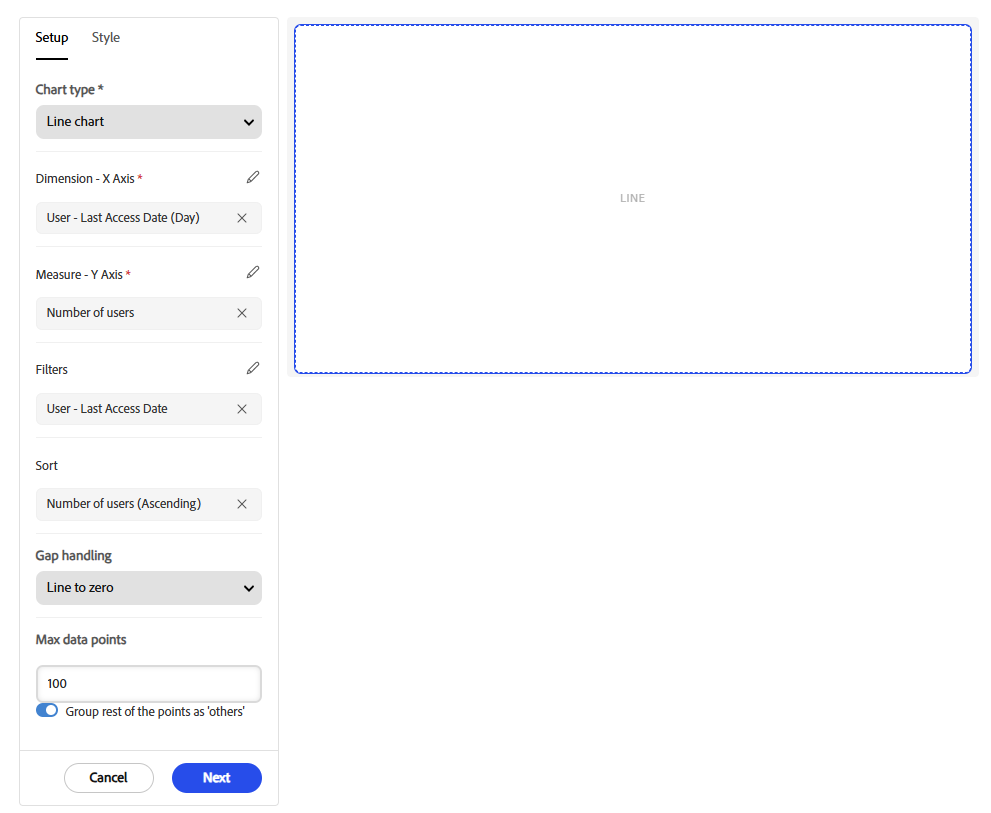
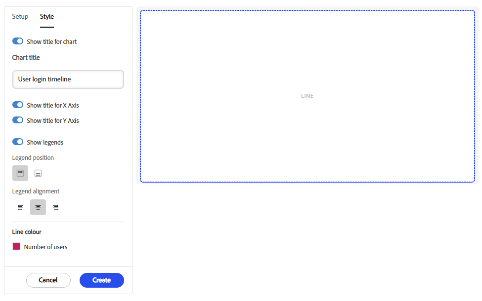
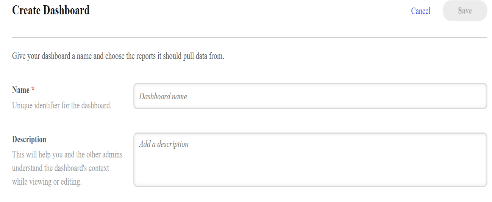
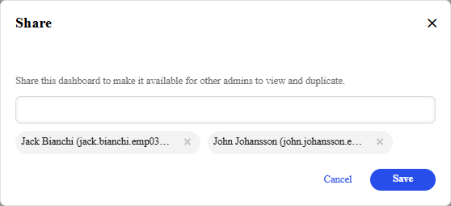

# Visualizaciones en Report Builder

Las visualizaciones en Adobe Learning Manager Report Builder convierten un informe guardado en gráficos y paneles. Puedes comparar grupos, detectar tendencias y compartir resultados sin reformar los datos en una herramienta de hoja de cálculo.

>[!IMPORTANT]
>
>Las visualizaciones (tablas y paneles) en Report Builder solo están disponibles para los clientes de Adobe Learning Manager Ultimate. No están disponibles con la edición Prime.

## Acerca de las visualizaciones en Report Builder {#about-visualizations}

Una visualización es un gráfico, o un panel de gráficos, creado a partir de un informe guardado en Report Builder. Puede elegir las columnas del informe que desea trazar y Report Builder dibujará el gráfico a partir de los datos del informe. Puede trazar columnas directamente o trazar datos resumidos de un informe.

* **Crear gráficos para un informe:** Abra el informe, seleccione **Visualización** y cree gráficos. Consulte [Crear un gráfico a partir de un informe](#create-chart-from-report).
* **Agrupar gráficos en un panel:** Elija informes como origen de datos y, a continuación, agregue gráficos desde ellos. Consulte [Crear un panel](#build-dashboard).
* **Compartir y ver:** Comparta un panel con administradores que lo vean y lo filtren en modo de solo lectura.

Los gráficos funcionan en dos modos:

* **Configurar modo:** Crea o edita el gráfico.
* **Modo de vista:** Filtra lo que muestra el gráfico sin cambiar su forma de generación.

## Tipos de gráficos y cuándo utilizarlos {#chart-types}

Elija el tipo de gráfico por la pregunta que desea responder.

| Tipo de gráfico | Utilícelo para | Ejemplo |
|---|---|---|
| Línea | Muestra cómo cambia un valor con el tiempo. | Inscripciones por mes de creación |
| Barra o columna | Compara valores entre categorías. Hay disponibles diseños agrupados, apilados y 100 % apilados. | Alumnos por estado de inscripción |
| Circular | Muestra la parte de un todo de cada categoría. Los segmentos por debajo del 1 % se agrupan en un segmento **Otros**. | Inscripciones por catálogo |
| Gran número | Resalte una métrica clave. | Total de finalizaciones de este trimestre |
| Tabla | Mostrar valores exactos. Puede elegir un subconjunto de columnas y mostrar una columna de fecha como filas en lugar de columnas (vista de columna a fila). | Tiempo de aprendizaje dedicado por usuario al mes |

>[!NOTE]
>
>Los gráficos de líneas creados a partir de informes de tendencias, como las inscripciones por mes, muestran la instantánea actual de los datos agrupados por fecha. No muestran el aspecto de los datos en cada fecha pasada. Para obtener más información, consulte Conceptos y terminología de Report Builder.

## Términos de visualización {#visualization-terms}

| Término | Significado |
|---|---|
| Informe | Una configuración de Report Builder guardada de columnas, filtros y grupos. Los gráficos se crean a partir de informes. |
| Filtro de nivel de gráfico | Filtro que se establece al crear o editar un gráfico. Limita los datos que traza el gráfico. |
| Filtro de nivel de página | Un filtro de un visor se aplica a todos los gráficos de una página o panel. Puede reducir, pero no ampliar, los propios filtros del informe. |
| tablero del Report Builder | Una página de gráficos que se genera en Report Builder. |

## Crear un gráfico a partir de un informe {#create-chart-from-report}

Cree un gráfico a partir de un informe guardado para ver de un vistazo los datos de inscripción, finalización o tiempo empleado. El gráfico se configura una vez y se extrae de los datos del informe cada vez que se abre.

### Antes de crear un gráfico {#before-you-create-chart}

Confirme lo siguiente:

* **Guarde el informe.** La opción para agregar un gráfico aparece en la página Report Builder después de guardar el informe.
* **Usa tu propio informe.** Duplique un informe compartido para crear su propia copia y, a continuación, utilícelo para crear gráficos.
* **Comprobar el tamaño.** No se puede trazar un informe con más de 10 millones de filas. No se traza un informe resumido con más de 10.000 puntos de datos. Consulte Límites del gráfico y del tablero.
* **Optimizar los datos para su visualización.** Aplique los filtros adecuados en el nivel de informe o de gráfico para limitar la cantidad de datos trazados. El tiempo necesario para cargar un gráfico depende de factores como el volumen de datos del informe, el intervalo de fechas seleccionado y la combinación de conjuntos de datos y tablas que se utilizan en el informe. Los informes que procesan grandes volúmenes de datos o combinaciones complejas de conjuntos de datos pueden tardar más en cargarse o pueden agotarse. Si esto ocurre, restrinja los filtros o el intervalo de fechas e inténtelo de nuevo.
* **Conoce tus columnas.** El eje X (dimensión) y el eje Y (medida) del gráfico proceden de las columnas del informe. Para resumir el propio informe, use **Agrupar por** y agregados. Para obtener más información, consulte Aplicación de agregaciones y grupos.

### Configurar un gráfico {#configure-chart}

1. Inicie sesión en Adobe Learning Manager como administrador.
1. Seleccione **Informes** y, a continuación, seleccione **Report Builder**.
1. Seleccione la ficha **Informes** y, a continuación, abra un informe guardado. En este ejemplo, seleccione un informe de tendencia de inicio de sesión de usuario, que muestra el número de usuarios que han iniciado sesión en la plataforma de aprendizaje en cada fecha.
1. En la barra de navegación izquierda, seleccione **Visualización**. Se abre un panel con las fichas **Configuración** y **Estilo**.

   

   >[!NOTE]
   >
   >Una vez que exista un gráfico, seleccione **Editar** y, a continuación, seleccione **+** para agregar otro gráfico.

1. En **Tipo de gráfico**, seleccione un tipo, como **Gráfico de líneas**. Este campo es obligatorio.
1. Junto a **Dimension - Eje X**, seleccione el icono de adición y, a continuación, seleccione la columna del informe. Para una columna de fecha, seleccione también una **granularidad de fecha**, como día o mes.

   {width="650"}

1. Seleccione **Agregar** para agregar la dimensión de fecha.
1. Junto a **Medida - Eje Y**, seleccione el icono de adición y, a continuación, seleccione la columna de informe y cómo agregarla, como **Recuento**.

   {width="650"}

1. Seleccione **Agregar** para agregar la medida.
1. (Opcional) Seleccione **Agregar filtro** para limitar los datos trazados a un rango, como los últimos 30 días. Seleccione **Agregar**.

   {width="650"}

1. (Opcional) Agregue una columna **Ordenar** y, a continuación, seleccione **Ascendente** o **Descendente**. Seleccione **Agregar**.

   {width="650"}

1. (Opcional) Para un gráfico de líneas, establezca **Control de huecos** para los datos que faltan. Consulte [Control de huecos para ver los datos que faltan](#gap-handling).
1. En **Máximo de puntos de datos**, escriba el número de puntos de datos que se van a trazar en el gráfico. El valor predeterminado es 100 puntos y el límite es 10 000.
1. Active **Agrupar el resto de los puntos como &#39;otros&#39;**. El Report Builder muestra puntos de datos individuales hasta el valor **Máximo de puntos de datos** y combina todo lo que supera ese límite en una categoría adicional denominada **Otros**.

   Por ejemplo, si **Puntos de datos máximos** es 150 y la consulta devuelve 200 puntos:

   * Report Builder muestra 150 puntos individualmente.
   * Report Builder combina los 50 puntos restantes en **Otros**.
   * El gráfico muestra 151 puntos trazados: 150 más **Otros**.

1. Seleccione **Siguiente**. Ahora puede personalizar el gráfico.

   {width="650"}

#### Control de huecos para datos que faltan {#gap-handling}

El control de huecos define lo que hace el gráfico cuando una o varias observaciones de una serie no tienen ningún valor numérico, como NULL, NA, NaN o una celda vacía.

Supongamos que los datos son:

| X | Valor |
|---|---|
| Ene | 10 |
| Febrero | 15 |
| Mar | N/D |
| Abr | N/D |
| Mayo | 25 |

En la tabla siguiente se muestran los tres comportamientos.

| Gestión de huecos | Resultado conceptual | Cómo se traza |
|---|---|---|
| Línea hasta cero | `10 -> 15 -> 0 -> 0 -> 25` | Trata los valores que faltan como 0. |
| Omitir | `10 -> 15   25` | No traza los puntos que faltan y rompe la línea. |
| Conectar | `10 -> 15 ----> 25` | No traza los puntos que faltan, pero conecta las observaciones válidas de cada lado. |

>[!NOTE]
>
>La conexión no es interpolación. Si faltan marzo y abril, al conectar febrero directamente con mayo solo se dibuja una línea visual entre los dos valores conocidos. No crea valores reales de marzo y abril.

### Personalizar el gráfico {#customize-chart}

Personalice un gráfico para que sea claro y fácil de leer. En la ficha **Estilo**, puede agregar un título, mostrar u ocultar títulos y leyendas de ejes, colocar y alinear la leyenda, y establecer un color para cada serie. Los cambios de estilo sólo afectan al aspecto del gráfico. No cambian los datos que traza.

1. Para mostrar un título encima del gráfico, seleccione **Mostrar título para el gráfico**. Para ocultarlo, desactive la opción.
1. En **Título del gráfico**, escriba un título para el gráfico.
1. Seleccione **Mostrar título del eje X** y **Mostrar título del eje Y** para etiquetar los ejes.
1. Para mostrar una clave que identifique cada línea, seleccione **Mostrar leyendas**.
1. En **Posición de la leyenda**, selecciona el icono izquierdo, central o derecho para alinear la leyenda.
1. En **Color de línea**, seleccione la muestra de color junto a una serie, como **Número de usuarios**.
1. En el selector de color, elija un color de la paleta o utilice la ficha personalizada para definir el suyo propio.
1. Repita los dos pasos anteriores para cada línea que desee volver a colorear.
1. Seleccione **Crear** para agregar el gráfico. Si estás editando un gráfico existente, selecciona **Guardar**.

   {width="650"}

El gráfico aparece con los títulos, la leyenda y los colores de línea.

>[!TIP]
>
>* Elige colores que contrasten claramente entre sí y con el fondo. Mantén los títulos y la leyenda activados para que el color no sea la única forma de distinguir las líneas.
>* Las opciones **Posición de leyenda**, **Alineación de leyenda** y **Color de línea** solo se aplican cuando está activada la opción **Mostrar leyendas**.
>* Cada línea del gráfico tiene su propia muestra, una por medida agregada en la ficha **Configuración**.

Para organizar los gráficos en una sola página, vea [Crear un panel](#build-dashboard).

## Crear un gráfico circular {#create-pie-chart}

Utilice un gráfico circular para mostrar cómo un todo se divide en partes, como el porcentaje de empleados que han completado la formación obligatoria o la combinación de formatos de curso. Cada sector muestra la parte del total correspondiente a una categoría.

### Acerca de los gráficos circulares {#about-pie-charts}

Un gráfico circular dibuja un sector por categoría. El tamaño del sector muestra la parte de la medida total correspondiente a esa categoría. Una leyenda identifica cada sector y cada sector muestra su valor.

Utilice un gráfico circular para mostrar partes de un todo en algunas categorías, cuando los usuarios necesitan una proporción mayor que los valores exactos. Para comparar muchas categorías, utilice un gráfico de barras. Para mostrar los cambios a lo largo del tiempo, utilice un gráfico de líneas.

### Pasos para crear un gráfico circular {#pie-chart-steps}

Antes de empezar, guarde un informe que posea. Incluya una columna para las categorías y una columna para medir.

1. Seleccione **Informes** y, a continuación, seleccione **Report Builder**. En la ficha **Informes**, abra el informe guardado.
1. En la barra de navegación izquierda, seleccione **Visualización**.
1. En **Tipo de gráfico**, seleccione **Gráfico circular**.
1. Junto a **Dimension - Segmento**, seleccione el icono de adición y, a continuación, seleccione la columna que define los sectores. Por ejemplo, seleccione **Transcripción (objeto de aprendizaje) - Estado**.
1. Junto a **Medida - Valor**, seleccione el icono de adición y, a continuación, seleccione la columna y agregue los sectores cuyo tamaño desee, como **Recuento**.
1. (Opcional) En **Máximo de puntos de datos**, escriba el número máximo de sectores que se van a dibujar. El valor predeterminado es 100.
1. (Opcional) Para combinar categorías secundarias, active **Agrupar el resto de los puntos como &#39;otros&#39;**.
1. Seleccione **Siguiente** para personalizar el gráfico circular.

### Personalizar el gráfico circular {#customize-pie-chart}

1. Para mostrar un título, active **Mostrar título para el gráfico**. Desactívelo para ocultar el título.
1. En **Título del gráfico**, escriba un título, como `Mandatory Compliance Completion`.
1. En **Estilo de gráfico**, selecciona **Circular** para un círculo sólido o **Donut** para un anillo.
1. Seleccione **Mostrar leyendas** para mostrar la leyenda en el gráfico.
1. En **Posición de la leyenda**, seleccione dónde aparece la leyenda.
1. En **Alineación de leyenda**, seleccione izquierda, centro o derecha.
1. Seleccione **Crear** para un nuevo gráfico. Cuando edites un gráfico existente, selecciona **Guardar** y, a continuación, selecciona **Guardar** en la página **Visualización**.

   {width="650"}

Report Builder crea el gráfico circular o de rosquilla.

## Crear un gráfico de barras {#create-bar-chart}

Utilice un gráfico de barras para comparar una medida entre categorías, como el estado de la formación por equipo o el tiempo de aprendizaje por cliente. Las barras son fáciles de comparar y clasificar, y puede agruparlas o apilarlas para agregar un segundo desglose.

### Acerca de los gráficos de barras {#about-bar-charts}

Un gráfico de barras dibuja una barra para cada categoría del eje X. La longitud de la barra muestra la medida en el eje Y, como un recuento de alumnos. Puede dibujar barras verticalmente (columnas) u horizontalmente.

Utilice un gráfico de barras para:

* Compara valores en distintas categorías, como equipos, partners o clientes.
* Clasificar categorías de mayor a menor.
* Mostrar un segundo desglose dentro de cada barra, como el estado dentro de cada socio.

### Antes de crear un gráfico de barras {#before-you-create-bar-chart}

* Guarde el informe y use un informe de su propiedad.
* Incluya una columna para las categorías y una columna para medir.
* Mantenga el informe dentro de los límites establecidos en Límites del gráfico y del tablero.

### Pasos para crear un gráfico de barras {#bar-chart-steps}

1. Seleccione **Informes** y, a continuación, seleccione **Report Builder**. En la ficha **Informes**, abra el informe guardado.
1. En la barra de navegación izquierda, seleccione **Visualización**.
1. En **Tipo de gráfico**, seleccione **Gráfico de barras**.
1. Junto a **Dimension - Eje X**, seleccione el icono de adición y, a continuación, seleccione la columna que define las categorías. Seleccione **Listo**.

   {width="650"}

1. Junto a **Medida - Eje Y**, seleccione el icono de adición y, a continuación, seleccione la columna y cómo agregarla, como **Recuento**. Seleccione **Listo**.

   {width="650"}

1. (Opcional) Agregue **Filtros** para limitar los datos y configure **Ordenar** para ordenar las barras por columna.
1. En **Máximo de puntos de datos**, escriba el número máximo de puntos de datos para trazar. Si introduce 150, Report Builder mostrará hasta 150 puntos de datos individuales y combinará todo lo que supere ese límite en una categoría adicional denominada **Otros**.
1. Seleccione **Siguiente** para personalizar el gráfico de barras.

### Personalizar el gráfico de barras {#customize-bar-chart}

Use la ficha **Estilo** para establecer el título, la orientación, la agrupación, la leyenda y los colores. La configuración de estilos cambia el aspecto del gráfico, no los datos que traza.

1. Seleccione la ficha **Estilo**.
1. Para mostrar un título, active **Mostrar título para el gráfico**. En **Título del gráfico**, escriba un título, como `Most Popular Courses`.
1. Para etiquetar los ejes, active **Mostrar título para el eje X** y **Mostrar título para el eje Y**. Desactive una opción para ocultar ese título.
1. En **Estilo de gráfico**, selecciona **Vertical** para las columnas o **Horizontal** para las barras que se ejecutan de lado. Las barras horizontales dejan más espacio para nombres de categoría largos.
1. En **Agrupación de barras**, seleccione uno de los tres iconos para establecer cómo varias series comparten una categoría: agrupadas, apiladas o 100% apiladas.
1. Para identificar cada serie, active **Mostrar leyendas**.
1. En **Posición de la leyenda**, seleccione dónde aparece la leyenda. En **Alineación de leyenda**, seleccione izquierda, centro o derecha.
1. En **Color de barra**, seleccione la muestra junto a una serie y, a continuación, elija un color.
1. Seleccione **Crear** para un nuevo gráfico. Cuando edites un gráfico existente, selecciona **Guardar**.

>[!NOTE]
>
>**La agrupación de barras** sólo importa cuando una barra tiene más de una serie, como dos medidas. Mantén la leyenda encendida y muestra etiquetas de datos, para que el color no sea la única forma de diferenciar las series.

## Crear un número grande {#create-big-number}

Utilice un número grande para mostrar una métrica clave como una cifra grande y fácil de leer, como el total de alumnos, inscripciones atrasadas o usuarios activos. Los números grandes funcionan bien en la parte superior de un tablero, donde los espectadores consultan primero las cifras clave.

### Acerca de los números grandes {#about-big-numbers}

Un número grande es un azulejo con dos partes: un valor y una etiqueta. El valor es un único número calculado a partir del informe, como un recuento o una suma. La etiqueta indica a los espectadores lo que significa el número. Un número grande no tiene ejes, leyendas ni categorías.

Utilice un número grande para:

* Mostrar una figura de titular que alguien comprueba regularmente.
* Proporciona contexto a un tablero antes de los gráficos detallados que se encuentran debajo de él.

### Pasos para crear un número grande {#big-number-steps}

Antes de empezar, guarde un informe que posea. Decida el número que desea y la columna y el agregado que lo producen.

Por ejemplo, los administradores de formación informan cada mes de la cantidad de formación que ha completado la organización. Los responsables quieren una figura principal, no una lista de inscripciones, y los administradores desean actualizarla sin volver a crear el informe.

1. Seleccione **Informes** y, a continuación, seleccione **Report Builder**. En la ficha **Informes**, abra el informe guardado.
1. En la barra de navegación izquierda, seleccione **Visualización**.
1. En **Tipo de gráfico**, seleccione **Número grande**.
1. En **Medida - Valor**, seleccione **Transcripción (objeto de aprendizaje) - Estado** y, a continuación, aplique el agregado **Count**. Seleccione **Listo**.

   {width="650"}

1. Seleccione el número de dígitos que se mostrarán después del separador decimal. Puede seleccionar un máximo de dos dígitos.
1. En **Pantalla**, seleccione cómo se acortan los números grandes. Selecciona **K** para miles, **M** para millones, **B** para miles de millones o **Ninguno** para mostrar el valor completo. **Automático** selecciona automáticamente la unidad adecuada. Seleccione **Siguiente**.

   {width="650"}

### Personalizar el número grande {#customize-big-number}

Use la ficha **Estilo** para personalizar las propiedades de leyenda del número grande.

1. En **Título de leyenda**, escriba el texto que dé nombre al número. Por ejemplo, escriba `Total Course Completions`.
1. En **Posición de la leyenda**, seleccione uno de los dos iconos para establecer dónde aparece el título.
1. En **Alineación de leyenda**, seleccione izquierda, centro o derecha.
1. Seleccione **Crear** para un nuevo gráfico. Cuando edites un gráfico existente, selecciona **Guardar**.

   {width="650"}

## Crear una tabla o un gráfico dinámico {#create-table-pivot-chart}

Utilice una tabla dinámica para resumir un número en dos categorías, como el número de alumnos de cada equipo del responsable que han completado, iniciado o no iniciado el aprendizaje necesario. También puede cambiar a una vista de estilo dinámico, en la que las fechas o las categorías se extienden por la parte superior de la tabla, de modo que cada alumno o curso quepa en una fila.

### Acerca de los gráficos de tablas y tablas dinámicas {#about-table-pivot}

Una tabla dinámica es una cuadrícula con una categoría en el lateral, una categoría en la parte superior y un número en cada celda. Cada celda muestra la medida de un valor de fila y un valor de columna. Se genera con tres configuraciones en la ficha **Configuración**.

| Configuración | Qué hace | En el ejemplo |
|---|---|---|
| **Dimension - Columnas** | Los valores de este campo se convierten en encabezados de columna en la parte superior. | **Transcripción (objeto de aprendizaje) - Estado**: Completado, En curso, No iniciado |
| **Dimension - Filas** | Los valores de este campo se convierten en los rótulos de fila del lado izquierdo, una fila por cada valor. | **Usuario: nombre del administrador** |
| **Medida - Valor** | El número de cada celda. Elige una columna y un agregado, como **Count**. Aparece como el nombre de la columna seguido de **Agregado por: Recuento**. | Recuento de alumnos |

Una dimensión es un campo por el que se agrupa. Una medida es un número que se calcula.

### Antes de crear un gráfico de tabla {#before-you-create-table-chart}

* Para utilizar la vista de columna a fila, agrupe el informe por la columna que desee como encabezados, como una fecha.
* Si agrupa por más de una columna de fecha, seleccione una de ellas para los encabezados.

### Pasos para crear un gráfico de tabla {#table-chart-steps}

1. Seleccione **Informes** y, a continuación, seleccione **Report Builder**. En la ficha **Informes**, abra el informe guardado.
1. En la barra de navegación izquierda, seleccione **Visualización**.
1. En **Tipo de gráfico**, seleccione **Tabla / Tabla dinámica**.
1. Junto a **Dimension - Filas**, seleccione el icono de adición y, a continuación, seleccione **Usuario - Nombre del responsable**.
1. Junto a **Dimension - Columnas**, seleccione el icono de adición y luego seleccione **Transcripción (objeto de aprendizaje) - Estado**.
1. Junto a **Medida - Valor**, seleccione el icono de adición. Seleccione la medida **Transcripción (objeto de aprendizaje) - Estado** y, a continuación, seleccione **Agregar**.

   {width="650"}

1. Active una de las opciones siguientes o ambas, según sus requisitos de informes:

   * **Mostrar total general de columnas:** Muestra el total general de cada columna. Por ejemplo, si la tabla muestra los datos de ventas en distintas regiones, el total general muestra el total de ventas de cada columna.
   * **Mostrar total general de las filas:** Muestra el total general de cada fila. Por ejemplo, si la tabla muestra las ventas mensuales de diferentes productos, el total general muestra las ventas totales de cada fila.

1. En **Número de filas que se mostrarán (máximo 20)**, escriba cuántas filas se mostrarán en la tabla a la vez. El valor predeterminado es 10 y el máximo es 20. Por ejemplo, 15 muestra 15 filas por página.
1. Seleccione **Siguiente**.

### Personalizar la tabla {#customize-table}

Use la ficha **Estilo** para agregar el título del gráfico, colorear el encabezado de la tabla y colorear las filas de la tabla.

1. En **Título del gráfico**, escriba el título que desea mostrar, como `Status of Learning`.
1. Seleccione **Color de fila de encabezado** para aplicar un color de fondo a la fila de encabezado.
1. Active **Resaltar filas alternativas** para aplicar colores alternativos a las filas y facilitar su lectura.
1. Seleccione **Color 1** y elija el primer color para las filas alternas.
1. Seleccione **Color 2** y elija el segundo color para las filas alternas.
1. Seleccione **Guardar** para aplicar la configuración de estilo al gráfico.

## Crear un panel {#build-dashboard}

Un panel coloca en una sola página los gráficos de uno o varios informes. Crea uno cuando respondas las mismas preguntas repetidamente, como cuántas personas completaron el entrenamiento este mes o qué equipos están detrás.

### Paneles de Report Builder {#about-dashboards}

Un tablero es una página de gráficos. Puede elegir los informes de los que obtiene, denominados orígenes de datos, y, a continuación, agregar gráficos de esos informes. Los gráficos siempre provienen de informes, así que créelos primero en la página **Visualización** de cada informe. Sólo puede utilizar los informes que posea. El ámbito se aplica a todos los gráficos del panel.

### Crear el tablero {#create-dashboard}

1. Seleccione **Informes** > **Paneles**. La página muestra todos los paneles que ha creado.
1. Seleccione **Crear panel**.
1. Introduzca el nombre y la descripción del tablero.

   {width="650"}

1. En **Origen de datos**, seleccione **Agregar informe** para agregar los gráficos creados previamente a partir de los informes disponibles.
1. Seleccione uno o varios informes de la lista y, a continuación, seleccione **Agregar**.

   {width="650"}

El Report Builder agrega los informes al panel.

{width="650"}

### Ver los gráficos en el panel {#view-charts}

Seleccione **Gráficos** en el panel de navegación izquierdo del panel.

Opción {width="650"}

Todos los gráficos de los informes disponibles aparecen en el tablero.

{width="650"}

### Mover gráficos en el tablero de mandos {#move-charts}

1. Seleccione **Editar** en la esquina superior derecha del panel. Puede ver las columnas de cada informe que se utilizaron para crear los gráficos. También puede crear otro gráfico para agregarlo al panel.

   {width="650"}

1. En el panel izquierdo, seleccione los gráficos que desea agregar al panel.
1. Arrastre cada gráfico a la posición que desee y, a continuación, suéltelo para colocar el gráfico.
1. Repita el paso anterior para organizar los gráficos según sus requisitos de informes.
1. Seleccione **Guardar** para guardar todos los cambios en el panel.

### Compartir un tablero {#share-dashboard}

Comparta un tablero de Report Builder con otros administradores para que puedan ver los mismos gráficos y datos.

Los gráficos creados a partir de un informe se guardan con ese informe. Cuando comparta el informe, otros administradores también recibirán los gráficos. Comparta un tablero una vez en lugar de pedir a cada administrador que lo vuelva a generar.

#### Compartir un tablero con otros administradores {#share-with-administrators}

1. Inicie sesión en Adobe Learning Manager como administrador.
1. Seleccione **Informes** y, a continuación, seleccione **Report Builder**.
1. Seleccione la ficha **Informes** y, a continuación, abra el informe que contiene el panel.
1. Seleccione **Acciones** > **Compartir**.
1. En **Compartir**, seleccione **Editar**.
1. Seleccione el campo **Seleccionar usuarios / grupos de usuarios**.
1. Busque y seleccione los administradores o grupos de usuarios con los que desee compartir.

   {width="650"}

1. Seleccione **Guardar**.

Los administradores seleccionados ahora pueden ver el informe y sus gráficos en la vista Report Builder.

>[!NOTE]
>
>Los administradores con acceso compartido pueden ver, duplicar y editar el informe.

#### Quitar acceso compartido {#remove-shared-access}

1. Abra el informe y, a continuación, seleccione **Acciones** > **Compartir**.
1. En **Compartir**, seleccione **Editar**.
1. Anule la selección del administrador o grupo de usuarios.
1. Seleccione **Guardar**.

#### Prácticas recomendadas para compartir {#sharing-best-practices}

* Comparta un informe bien configurado en lugar de permitir que cada administrador cree una variación. Esto mantiene una versión autorizada de los datos.
* Crea el informe con filtros que se apliquen a todos los usuarios con los que lo compartes, para que todos los usuarios vean gráficos coherentes.

### Eliminación de un tablero {#delete-dashboard}

Elimine un tablero de Report Builder cuando ya no lo necesite. Al eliminar un tablero, este se elimina de forma permanente, así como su configuración de uso compartido asociada. Esta acción no se puede deshacer.

1. Inicie sesión en Adobe Learning Manager como administrador.
1. Seleccione **Informes** y, a continuación, seleccione **Report Builder**.
1. Seleccione la ficha **Informes** y, a continuación, abra el panel que desea eliminar.
1. Seleccione **Acciones** > **Eliminar**. Aparece el cuadro de diálogo **Se requiere confirmación**. Muestra el nombre del panel y los usuarios con los que se comparte el panel.

   {width="650"}

1. Seleccione una de las opciones siguientes:

   * **Editar uso compartido:** Revise o cambie los usuarios con los que se comparte el panel.
   * **Cancelar:** Cierre el cuadro de diálogo sin eliminar el panel.
   * **Eliminar panel:** Elimine permanentemente el panel y quite su configuración de uso compartido.