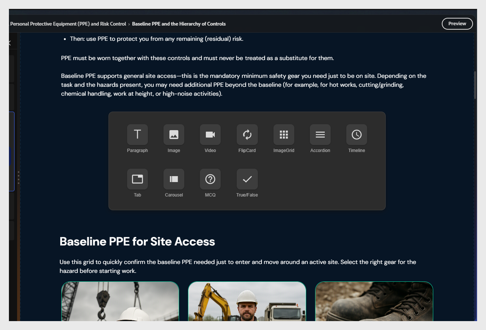
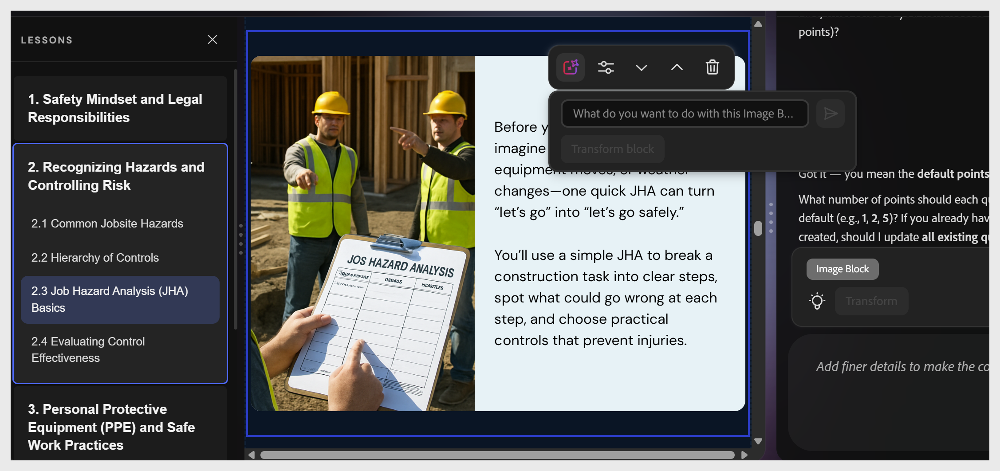

# Añadir un componente de contenido

Seleccione entre dos elementos existentes. Aparece el botón +. Selecciónelo para abrir el selector de componentes.

Componentes disponibles:

<table>
  <thead>
    <tr>
      <th>Componente</th>
      <th>Utilizar para</th>
    </tr>
  </thead>
  <tbody>
    <tr>
      <td><strong>Párrafo</strong></td>
      <td>Texto del cuerpo y explicaciones</td>
    </tr>
    <tr>
      <td><strong>Imagen</strong></td>
      <td>Ilustraciones, capturas de pantalla, diagramas</td>
    </tr>
    <tr>
      <td><strong>Vídeo</strong></td>
      <td>Vídeo MP4 incrustado o vinculado</td>
    </tr>
    <tr>
      <td><strong>Voltear tarjeta</strong></td>
      <td>Término o pares de definiciones, revelar interacciones</td>
    </tr>
    <tr>
      <td><strong>Cuadrícula de imágenes</strong></td>
      <td>Varias imágenes en un diseño de cuadrícula</td>
    </tr>
    <tr>
      <td><strong>Acordeón</strong></td>
      <td>Secciones ampliables, procedimientos paso a paso</td>
    </tr>
    <tr>
      <td><strong>Cronología</strong></td>
      <td>Eventos secuenciales o pasos del proceso</td>
    </tr>
    <tr>
      <td><strong>Objeto web</strong></td>
      <td>Incrustar contenido web externo, una página web, una herramienta interactiva, una encuesta o una aplicación web, directamente dentro de una diapositiva de tema</td>
    </tr>
    <tr>
      <td><strong>Pestaña</strong></td>
      <td>Contenido paralelo — comparaciones, variantes regionales</td>
    </tr>
    <tr>
      <td><strong>Carrusel</strong></td>
      <td>Serie de imágenes o tarjetas de contenido que se pueden desplazar</td>
    </tr>
    <tr>
      <td><strong>MCQ</strong></td>
      <td>Comprobación de conocimientos en línea sin graduar</td>
    </tr>
    <tr>
      <td><strong>Verdadero/falso</strong></td>
      <td>Comprobación en línea verdadera o falsa sin graduar</td>
    </tr>
  </tbody>
</table>

>[!NOTE]
>
>Usa **Acordeón** para los procedimientos paso a paso en los que los alumnos se benefician de controlar su ritmo. Usar **Flip Card** para contenido de términos o definiciones.

## Agregar un objeto Web a un curso de compositor de contenido

Un objeto Web muestra contenido externo en un marco en línea dentro del curso. Los alumnos interactúan con el contenido sin salir del curso. Utilícelo para herramientas interactivas, formularios incrustados, encuestas o cualquier recurso basado en web que admita la incrustación de iframe.

### Agregar un objeto Web

1. Abra el curso en el Compositor de contenido y vaya al tema en el que desee agregar el objeto Web.
2. Seleccione entre dos elementos existentes en la diapositiva de tema. Aparece el botón **+**.
3. Seleccione **+** para abrir el selector de componentes.
4. Seleccione **Objeto Web**. El bloque aparece en el lienzo.

### Configurar el objeto Web

Seleccione el icono **Settings** en la barra de herramientas Bloque de objeto web para abrir el panel de configuración.

### Establecer el origen de contenido

En **Contenido**, seleccione cómo se carga el contenido externo:

- **URL**: introduce la dirección web de la página o herramienta que deseas incrustar. El contenido se carga dentro del curso en un marco en línea.
- **Incrustar código**: pegue un fragmento de incrustación de un servicio de terceros. Utilícelo para herramientas que proporcionen su propio código incrustado, como formularios interactivos, encuestas o reproductores de medios.
- **Sistema**: selecciona contenido de un sistema o integración conectados.

### Definir el height de marco

En el campo **height de Marco**, establezca el height del marco de contenido incrustado en píxeles. Use los controles **+** y **-** para ajustar el valor. El valor predeterminado es 498 px.

Ajuste el height de marco para que coincida con el height natural del contenido incrustado. Si se establece en un valor demasiado bajo, se agrega una barra de desplazamiento dentro del marco; si se establece en un valor demasiado alto, se agrega un espacio en blanco debajo del contenido.

### Configurar opciones de carga y visualización

- **Carga automática**: cuando se selecciona, el contenido web se carga automáticamente cuando un alumno llega a la diapositiva. Desactive esta opción para las páginas con mucho contenido a fin de evitar que el curso se ralentice. Cuando la carga automática está desactivada, los alumnos seleccionan el marco para activar la carga.
- **Bloquear título**: active esta opción para mostrar un encabezado encima del bloque de objeto Web. Utilice esta opción para proporcionar a los alumnos contexto sobre el contenido incrustado antes de que interactúen con él.

## Mover bloques de contenido dentro de un tema

Puede reordenar bloques de contenido dentro de un tema mediante las opciones de edición de la barra de herramientas o la IA.

