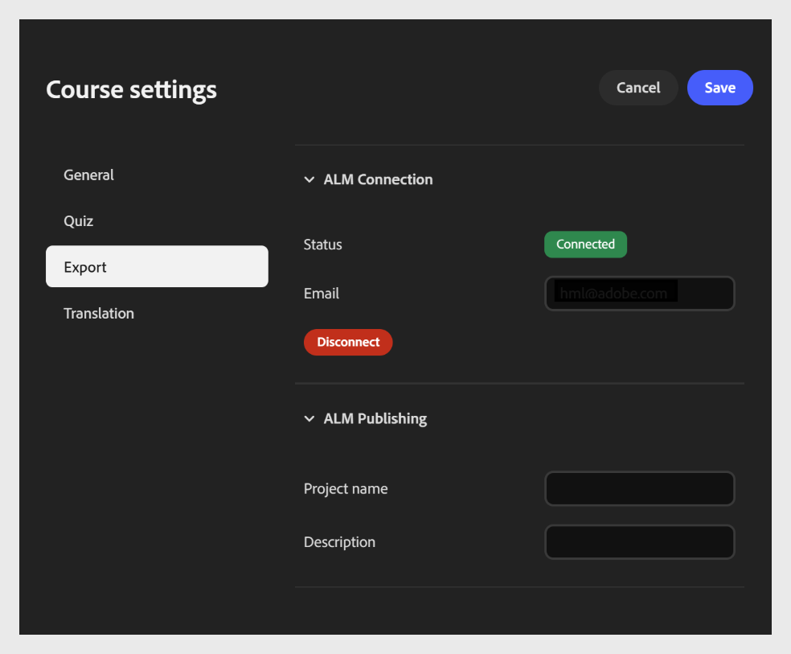
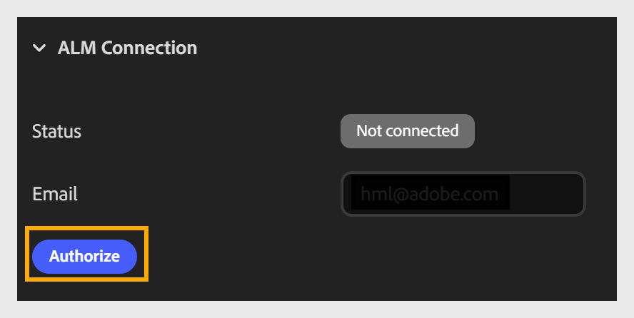
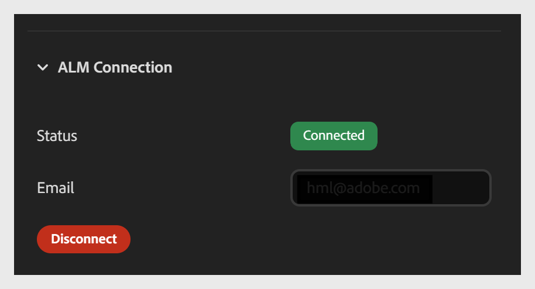

# Publish: un curso de compositor de contenido a Adobe Learning Manager

La pestaña **Exportar** te permite conectar tu curso a Adobe Learning Manager (ALM) y publicarlo directamente en la biblioteca de contenido de ALM. Para configurar la conexión, introduce tu correo electrónico en el campo **Correo electrónico**. Asegúrese de tener una cuenta de ALM con el mismo ID de inicio de sesión de correo electrónico. Una vez conectado, puede publicar el curso en ALM como módulo.

Esta conexión es una configuración de una sola vez por curso. Una vez establecido, no es necesario volver a conectarse cada vez que se publica o se exporta.

Tiene dos secciones:

- Sección Conexión de ALM

- Sección Publicación de ALM

**Para configurar la exportación**

1. Abra **Configuración del curso** y seleccione la pestaña **Exportar** situada a la izquierda.

2. Expanda la sección **Conexión ALM** (si aún no está expandida).

   - Indique su **dirección de correo electrónico** asociada con su cuenta de Adobe Learning Manager.

   - Seleccione **Autorizar** para iniciar sesión y conectar el curso a su cuenta de ALM.
     

   - Una vez autorizado, confirme las actualizaciones del campo **Status** de **Disconnect** a **Connected**.
     

## Detalles de publicación de Adobe Learning Manager

Después de conectar su cuenta, configure los detalles de publicación en la sección Publicación de ALM .

- Escriba un nombre de **proyecto** para identificar el curso. Este nombre aparece como título del curso en la biblioteca de contenido de ALM.

- Escriba una **Descripción**: un breve resumen del curso que aparece junto a él en la biblioteca de contenido de ALM, para que los alumnos y los administradores comprendan su propósito.

- Seleccione **Publish** para enviar el curso a la biblioteca de contenido de ALM como módulo.

## Navegación del alumno en cursos publicados de Content Composer

Aprenda a navegar por los cursos de Content Composer publicados en Adobe Learning Manager o exportados como paquetes SCORM, incluida la tabla de contenido contraíble y la navegación móvil.

## Tabla de contenido contraíble

Los cursos publicados en Adobe Learning Manager o exportados como paquetes SCORM incluyen una lección contraíble y un panel de navegación de temas.

Los alumnos pueden:

- **Expande** el panel de navegación para examinar lecciones y temas y saltar a cualquier sección.
- **Contraer** el panel de navegación para centrarse en el contenido del curso sin que el panel ocupe espacio en pantalla.
El estado del panel se mantiene a medida que los alumnos se desplazan por el curso.

## Navegación móvil

En dispositivos móviles, la navegación por lecciones y temas se abre como una superposición de pantalla completa en lugar de como un panel lateral. Los alumnos seleccionan el icono de navegación para abrir la superposición, buscan la lección o el tema que desean y lo seleccionan para ir allí.

La superposición se cierra automáticamente después de que el alumno seleccione un destino y lo devuelva al contenido del curso.
