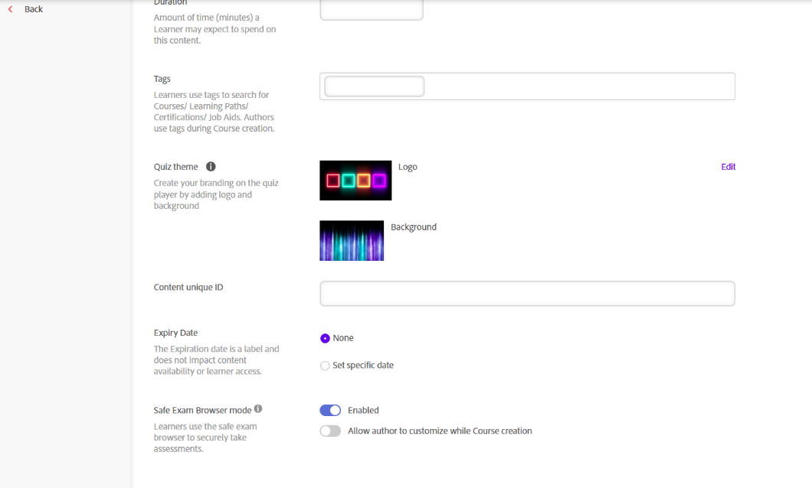

# Crear un curso con el Explorador de exámenes seguro

Los autores pueden añadir cuestionarios a los cursos que requieren un navegador de exámenes seguro para proporcionar un entorno de evaluación seguro y restringido. El Explorador de exámenes seguro solo se aplica a pruebas nativas individuales de Adobe Learning Manager y no restringe el acceso a otros módulos del curso.

Antes de añadir la prueba a un curso, asegúrese de que esté activado el Explorador de exámenes seguros para la prueba. Si el curso incluye otros tipos de entrega, como módulos de clase virtual, dichos módulos seguirán funcionando independientemente del requisito del Explorador de exámenes seguro.

En este artículo se explica cómo añadir a un curso una prueba habilitada para el Explorador de exámenes seguros y cómo establecer su configuración para el curso.

## Crear una prueba con el modo Explorador de exámenes seguro

El modo Explorador de examen seguro determina si los alumnos deben utilizar el Explorador de examen seguro para realizar la prueba. La opción solo aparece después de que un administrador active la integración Explorador de exámenes seguros para la cuenta. Vea **Habilitar el explorador de examen seguro** para obtener más información.

Para crear una prueba con el modo Explorador de exámenes seguro:

1. Inicie sesión en ALM como autor.
1. Seleccione **Crear contenido**.

   Aparece la página **Biblioteca de contenido**.

1. Seleccione **Agregar** > **Prueba**.

   Se abre la página **Crear prueba**.

1. Escriba un nombre para la prueba en el campo **Nombre**.
1. (Opcional) Introduzca una descripción para la prueba en el campo Descripción.
1. Seleccione **Agregar pregunta de prueba** y agregue los **Criterios para aprobar**.
1. Habilitar **modo Explorador de exámenes seguro**. Aparece la opción **Permitir que el autor personalice mientras se crea el curso**.

   

1. (Opcional) Habilite **Permitir al autor que personalice durante la creación del curso**.

   La opción Explorador de examen seguro aparece al configurar el código del curso.

   >[!NOTE]
   >
   > Si el administrador activa esta opción, puede activar o desactivar el requisito del Explorador de examen seguro (SEB) para un módulo de prueba de curso. Si el administrador desactiva esta opción, SEB se convierte en obligatorio para la prueba y no se puede cambiar este requisito.

1. Seleccione **Publish**.

## Añadir a un curso una prueba habilitada para el Explorador de exámenes seguros

Añada la prueba como un módulo con ritmo personalizado para que sea necesario un navegador de examen seguro para esa evaluación. Antes de comenzar, asegúrese de que la prueba se publique con el Explorador de exámenes seguros activado. Para obtener más información, consulte Habilitar el navegador de exámenes seguro .

Para añadir la prueba a un curso:

1. Seleccione **Crear curso** e introduzca el nombre y la descripción del curso.
1. Seleccione **Agregar módulos** en la página **Módulos**.

   Aparece la ventana emergente Módulos.

1. Seleccione **Aprendizaje a ritmo personalizado**. Se abre el cuadro de diálogo **Módulo con ritmo personalizado**.

   

1. Seleccione la casilla de verificación junto a la prueba del Explorador de exámenes seguros que creó.
1. Seleccione **Agregar**. El cuestionario se añade al curso como un módulo con ritmo personalizado.
1. (Opcional) Para agregar otro tipo de entrega al curso, seleccione **Agregar más tipos de entrega** y configure el módulo requerido.
1. Seleccione **Guardar** > **Publish**.

   El curso ahora incluye una evaluación que requiere que los alumnos utilicen el navegador de exámenes seguro.
