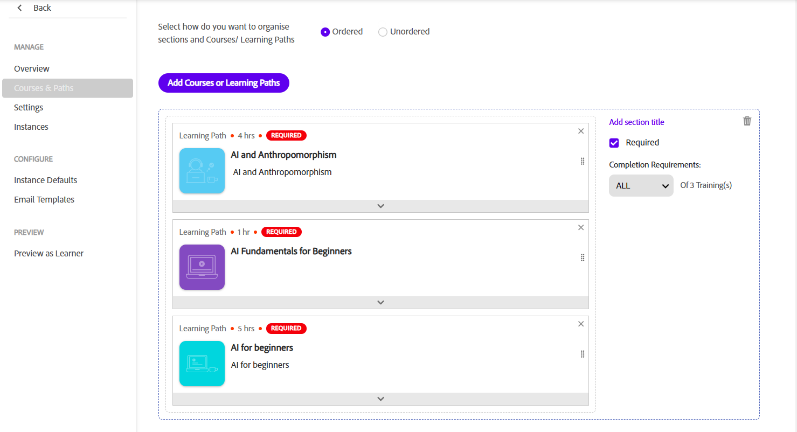

# Creación de una ruta de aprendizaje

Un autor puede crear una ruta de aprendizaje que consuman los alumnos. Para crear una ruta de aprendizaje en la aplicación de autor:

1. Inicie sesión como **autor**.
1. Seleccione **Aprendizaje** > **Rutas de aprendizaje**.
1. Seleccione **Agregar**.

   

1. **Nombre de ruta de aprendizaje**: Introduzca un nombre para la ruta de aprendizaje.
1. **Descripción general de la ruta de aprendizaje**: Introduzca una breve descripción general de la ruta de aprendizaje.
1. **Ventajas de esta ruta de aprendizaje**: Describe algunas ventajas del proceso de aprendizaje.
1. **Etiquetas**: Seleccione las etiquetas adecuadas de la lista predefinida.
1. **Id. de objeto de aprendizaje único**: Introduzca un ID exclusivo para el objeto de aprendizaje.
1. **Tipo de inscripción**: Seleccione el tipo de inscripción en el menú desplegable.
1. **Plan de precios**: Seleccione **Pagado** o **Gratis**. Si selecciona **Gratis**, se desactiva el cuadro **Precio de ruta de aprendizaje**.
1. **Dar de baja**: Seleccione esta opción para que los alumnos puedan darse de baja por sí mismos.
1. **Imagen de portada**: Seleccione una imagen de portada para el trazado de aprendizaje.
1. **Imagen del banner**: Seleccione una imagen de banner para la ruta de aprendizaje.
1. **Seleccionar catálogos**: Seleccione los catálogos correspondientes de la lista.
1. **Etiqueta de cumplimiento**: Seleccione la etiqueta de conformidad correspondiente en la lista.
1. **Etiquetas**: Seleccione la etiqueta adecuada de la lista.
1. **Id. de insignia credly**: Seleccione la etiqueta adecuada de la lista.
1. **Nivel de dificultad**: Seleccione el nivel de dificultad adecuado en la lista.
1. **Cumplimiento**: Seleccione el nivel de cumplimiento adecuado en la lista.

   >[!NOTE]
   >
   > En cualquier momento antes de guardar, puedes agregar un nuevo idioma seleccionando la pestaña **Agregar nuevo idioma**, seleccionando un idioma de la lista y, a continuación, seleccionando **Guardar**. El idioma predeterminado es el inglés.

   

1. Seleccione **Guardar**. Aparecerá una nueva página con el nombre de la ruta de aprendizaje. Ahora puede añadir aptitudes y productos, organizar secciones y añadir cursos o rutas de aprendizaje.

   

1. Seleccione **Los alumnos de aptitudes obtendrán**. En la sección que se abre, seleccione las aptitudes que desea que adquieran los alumnos y sus niveles.

   

1. Seleccione **Agregar**.
1. Seleccione cómo desea organizar las secciones y los cursos o las rutas de aprendizaje. Seleccione **Ordenado** o **Sin ordenar**.
1. A continuación, seleccione **Agregar cursos o rutas de aprendizaje**. Aparece una ventana con cursos y rutas de aprendizaje existentes. Cada mosaico muestra el nombre, el tipo (curso o ruta de aprendizaje), el estado de la publicación y el formato del curso. Si se trata de un curso, muestra el tipo de curso, como con ritmo personalizado, virtual, de clase o mixto. Si se trata de una ruta de aprendizaje, se muestra el número de cursos.

   

1. Seleccione los cursos o rutas de aprendizaje que desee añadir a la ruta de aprendizaje.

   

1. Seleccione **Agregar**. Los cursos y las rutas de aprendizaje aparecen en la página de rutas de aprendizaje.

   

1. Seleccione **Los alumnos de aptitudes obtendrán**. Seleccione las aptitudes y los niveles. Seleccione **Agregar**.
1. Asigne la ruta de aprendizaje a los productos. Para ello, seleccione los productos de la lista y, a continuación, seleccione sus niveles.

   >[!NOTE]
   >
   > Si no selecciona al menos un producto, no podrá publicar la ruta de aprendizaje.

   

1. Seleccione cómo desea organizar las secciones y los cursos o las rutas de aprendizaje. Seleccione **Ordenado** o **Sin ordenar**.
1. Seleccione **Agregar título de sección** y, a continuación, escriba un título de sección.

   

1. Seleccione **Enviar**.
1. Seleccione **Obligatorio** para que la ruta de aprendizaje sea obligatoria. Si no lo selecciona, la ruta de aprendizaje se convierte en opcional.
1. Si desea añadir otra sección con una ruta de aprendizaje diferente, repita los pasos del 24 al 30.
1. **Requisitos de finalización**: Seleccione **Todos** o un número de la lista para completar el entrenamiento.
1. Mueva los cursos hacia arriba o hacia abajo para cambiar su orden.
1. Para quitar un curso de la ruta de aprendizaje, seleccione **X** en la tarjeta del curso.
1. Seleccione **Publish**. Para ver la ruta de aprendizaje recién publicada, vuelva a la página **Rutas de aprendizaje**.
