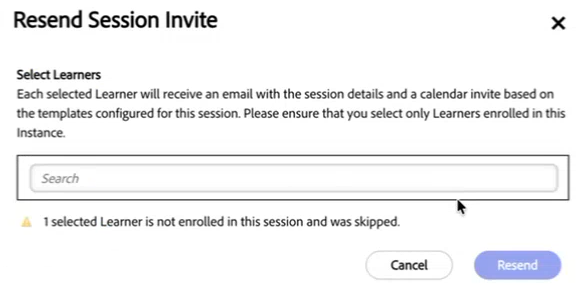

# Reenviar invitaciones de sesión

## Información general

>[!NOTE]
>
>La recuperación solo está disponible para sesiones de clase virtual (VC). No se admiten otros tipos de módulos, como los módulos de clase y los módulos de aprendizaje electrónico con ritmo personalizado.

Los alumnos pueden perder una invitación por varias razones. Con la opción **Reenviar**, como administrador que tiene permiso para editar cursos, puede abrir una sesión de clase virtual en la página de instancia, buscar a los alumnos y enviar el correo electrónico de invitación a la sesión. Learning Manager envía el correo electrónico bajo demanda, fuera del flujo del evento de inscripción. El alumno recibe los detalles de la sesión y una invitación de calendario, y el estado de inscripción sigue siendo el mismo.

## Casos de uso

A continuación se indican los casos prácticos en los que se reenviaría una invitación a la sesión.

* **Recuperar una invitación perdida.** Vuelva a enviar la invitación a un alumno con el buzón lleno, cuyo correo electrónico se haya enviado como correo no deseado o cuyo correo electrónico original no se haya entregado.
* **Reducir no-shows.** Reenviar los detalles de la sesión y la invitación de calendario justo antes de la sesión o el día de la sesión.
* **Evitar soluciones alternativas de inscripción.** Vuelva a enviar una invitación sin dar de baja ni volver a inscribir al alumno, de modo que el estado de inscripción y el registro de la sesión permanezcan intactos.
* **Reducir tickets de soporte.** Los administradores resuelven por sí mismos las solicitudes de invitaciones no disponibles, sin involucrar al equipo de asistencia.

## Requisitos previos

* La sesión es una sesión de clase virtual.
* El alumno se inscribe en la sesión de destino. Learning Manager envía la invitación solo a los alumnos que se han inscrito en la sesión.
* La sesión ya existe. Esta función no crea ni modifica sesiones.
* Se utiliza la plantilla de correo electrónico existente Invitación de sesión. Esta función no introduce una nueva plantilla de correo electrónico.

## Configuraciones admitidas

| Elemento | Asistencia |
|--------------------|-----------------------------------------------------------------------------------------------------------|
| Funciones | Administradores con permiso para editar el curso. Instructores de las sesiones a las que están asignados. |
| Tipos de elementos de catálogo | Cursos y rutas de aprendizaje |
| Tipo de módulo | Sesiones de clase virtual |
| Sesiones | Períodos de sesiones actuales y futuros. Las sesiones anteriores no son compatibles. |
| Proveedores de clase virtual | Todos los proveedores configurados para la sesión, como Zoom, Teams y Adobe Connect |
| Plantillas de correo electrónico | Las plantillas configuradas para el objeto de aprendizaje: un correo electrónico con detalles de la sesión y una invitación de calendario |
| Destinatarios | Los alumnos individuales que se inscriben en la sesión. No se admiten grupos de usuarios. |
| Desencadenador | Manual, de la acción Reenviar invitación de sesión |

La función de responsable no tiene acceso a esta función en esta versión. La opción está oculta a los alumnos y responsables.

## Acceso a la acción Reenviar invitación de sesión

La ubicación de la acción depende de su función.

| Función | Dónde encontrar la acción |
|---------------|-----------------------------------------------------------------------------------------------------------------------------------------------------------------------------------------------------------------|
| Administrador | Abra el curso o la ruta de aprendizaje en el catálogo, vaya a Instancias y abra la instancia. En la sección Sesiones, busque la sesión de clase virtual y seleccione Reenviar invitación de sesión. Necesita permiso para editar el curso. |

## Cuadro de diálogo Reenviar

El cuadro de diálogo Reenviar invitaciones a sesión contiene los siguientes elementos.

| Elemento | Descripción |
|-----------------|---------------------------------------------------------------------------------------------------------------------------------------------------------------------------------------------------------------------------------------------------------------------------------------------------------------------------|
| Seleccionar alumnos | Un campo de búsqueda. Introduzca el nombre o la dirección de correo electrónico de un alumno para buscarlo y, a continuación, seleccione el alumno. Puede seleccionar más de un alumno. Una nota explica que cada alumno seleccionado recibe dos mensajes de correo electrónico: un correo electrónico con detalles de la sesión y una invitación de calendario, en función de las plantillas configuradas para el objeto de aprendizaje. |
| Cancelar | Cierra el diálogo sin enviar ningún correo electrónico. |
| Reenviar | Envía los mensajes de correo electrónico a los alumnos seleccionados. El botón está desactivado hasta que seleccione al menos un alumno. |

>[!NOTE]
>
>La búsqueda solo coincide con alumnos individuales. No puede buscar ni seleccionar grupos de usuarios.

## Reenviar una invitación a sesión

Realice los siguientes pasos como administrador.

1. Inicie sesión como administrador con permiso para editar el curso.
2. Vaya a **Aprendizaje** > **Cursos**.

   

3. Abra el curso a cuyas instancias desea acceder.

   

4. Vaya a la instancia a cuya sesión desee acceder.
5. En la sección **Detalles de la sesión** que aparece a continuación, seleccione **Reenviar invitación de sesión**.

   

6. Se abre el elemento emergente **Reenviar invitación de sesión**.

   

7. Busque el alumno o los alumnos a los que desea volver a enviar la invitación.

   

   

8. Seleccione **Reenviar**. Verá un mensaje que indica: &quot;Se ha enviado una invitación de sesión a los alumnos con &quot;x&quot;&quot;.&quot;

   

9. En caso de que uno de los alumnos seleccionados sea de otra sesión, verá un mensaje que indica: &quot;X alumno seleccionado no se ha inscrito en esta sesión y se ha omitido&quot;.

   

10. Después de unos minutos, los alumnos recibirán un correo con los detalles de la sesión, incluido un vínculo para unirse a ella.

Learning Manager valida que cada alumno seleccionado se ha inscrito en la sesión de destino y, a continuación, envía la invitación de sesión existente a los alumnos elegibles.

Cuando Learning Manager acepta la solicitud, el cuadro de diálogo se cierra y aparece un mensaje de confirmación: &quot;Se están enviando correos electrónicos de invitación a los alumnos de la sesión. Esto puede tardar algún tiempo en completarse&quot;. Los correos electrónicos suelen llegar en pocos minutos.

## Contenido de correo electrónico

Cada alumno seleccionado recibe el correo electrónico de detalles de la sesión y la invitación de calendario de la sesión. El contenido incluye el vínculo de unión a la sesión de clase virtual, la fecha y la hora, y los detalles de la sesión. El correo electrónico es el mismo que el de la invitación a la sesión original, ya que Learning Manager utiliza la misma plantilla.

## Comportamiento de inscripción múltiple

El reenvío es específico de una instancia. Si un alumno está inscrito en más de una instancia, al volver a enviar desde una instancia, se envía la invitación solo para esa instancia. No vuelve a activar las invitaciones para las otras instancias del alumno.

| Inscripción de alumnos | Acción | Resultado |
|------------------------------------------------|------------------------------------------------|----------------------------------------------------------------------------------|
| Instancia A e Instancia B | Volver a enviar desde la instancia A | Solo está presente la invitación a la instancia A. |
| Sólo instancia A | Volver a enviar desde la instancia A | La instancia Una invitación está presente. |
| Una instancia diferente de la sesión seleccionada | El alumno aparece en la búsqueda de nivel de curso | Learning Manager omite al alumno de la sesión seleccionada y muestra una advertencia. |

## Comportamiento en escenarios específicos

| Escenario | Comportamiento |
|--------------------------------------------------------|------------------------------------------------------------------------------------------------------------------------------------------------------------------------------------------------------------------------------|
| La instancia no tiene sesiones de clase virtual | La acción de invitación a reenviar sesión no está disponible. |
| La sesión ya se ha producido | La acción no está disponible. Learning Manager solo admite sesiones actuales y futuras. |
| Seleccione un alumno que no esté inscrito en la sesión | La búsqueda de alumnos abarca todo el curso, por lo que puede encontrar alumnos de otras instancias. Learning Manager omite a los alumnos que no se han inscrito en la sesión seleccionada, envía la invitación a los demás y muestra una advertencia. |
| Un alumno se inscribe en varias instancias | Learning Manager solo envía la invitación para la instancia desde la que se envía. No envía invitaciones para las otras instancias. |
| Se selecciona una instancia de ruta de aprendizaje | La acción funciona del mismo modo que para una instancia de curso. |

## Gestión de errores

Si un error impide que Learning Manager envíe los mensajes de correo electrónico, el cuadro de diálogo muestra uno de los mensajes siguientes.

| Condición | Mensaje |
|---------------------------------------|------------------------------------------------------------------------|
| La plantilla de correo electrónico de invitación está desactivada | Error al enviar el correo electrónico: la plantilla de correo electrónico de invitación está desactivada actualmente. |
| Cualquier otro error | Se ha producido un error al enviar el correo electrónico. Inténtelo de nuevo más tarde. |

Si selecciona alumnos que no están inscritos en la sesión, Learning Manager muestra una advertencia que indica que se omitió la invitación para esos alumnos. Sigue enviando la invitación a los alumnos que se han inscrito.

>[!NOTE]
>
>El servicio de correo electrónico notifica el estado de entrega a Learning Manager de forma asincrónica, una vez cerrado el cuadro de diálogo.

## limitaciones

* Puede volver a enviar invitaciones solo para sesiones actuales y futuras.
* Solo se utilizan las plantillas configuradas para el objeto de aprendizaje. No puede seleccionar una plantilla diferente.
* Puede volver a enviar invitaciones para una sesión a la vez. No se admite el reenvío en varias instancias a la vez.
* No puede seleccionar grupos de usuarios. Solo puede seleccionar alumnos individuales.
* Learning Manager solo envía invitaciones a los alumnos que se han inscrito en la sesión seleccionada.
* El cuadro de diálogo no muestra el estado de entrega de los mensajes de correo electrónico y no ofrece un reintento para alumnos individuales.
* No se pueden programar nuevas sesiones ni editar los detalles de las sesiones existentes desde el cuadro de diálogo.

## Resolución de problemas

| Síntoma | Causa probable | Acción |
|---------------------------------------------------------------------|-------------------------------------------------------------------------------------------------------------------|---------------------------------------------------------------------------------------------------------------------|
| La acción de invitación a reenviar sesión no está visible | El módulo no es una sesión de clase virtual, la sesión ya se ha realizado o no tiene permiso para editar el curso. | Confirme que la sesión es una sesión de clase virtual actual o futura. Pida a un administrador que verifique los permisos del curso. |
| Aparece una advertencia después de enviar los mensajes de correo electrónico | Uno o más alumnos seleccionados no se inscriben en la sesión seleccionada. | Compruebe qué alumnos se inscriben en la sesión y vuelva a enviar la invitación desde la sesión o instancia correcta. |
| La invitación se envía para la instancia incorrecta | El alumno se inscribe en varias instancias y se presenta la invitación desde una instancia diferente. | Abra la instancia que necesite el alumno y vuelva a enviar la invitación desde allí. |
| Aparece el error &quot;La plantilla de correo electrónico de invitación está desactivada actualmente&quot; | La plantilla de correo electrónico de invitación está desactivada para el objeto de aprendizaje. | Pida a un administrador que habilite la plantilla y vuelva a enviar la invitación. |
| El correo electrónico actual es igual que la invitación original | Esto es de esperar. Learning Manager reutiliza la plantilla existente Invitación de sesión. | No se requiere ninguna acción. |
| Tienes que volver a enviar invitaciones en varias instancias a la vez | Esto no se admite. | Vuelva a enviar las invitaciones de cada instancia por separado. |
| Debe volver a enviar una invitación para una clase o un módulo de aprendizaje electrónico | Esto no se admite. La recuperación solo está disponible para sesiones de clase virtual. | No hay ninguna acción disponible para estos tipos de módulos. |
| Un alumno afirma que el correo electrónico no ha llegado | El correo electrónico aún se está procesando, el buzón del alumno está lleno o se ha filtrado como correo no deseado. | Espere unos minutos, pida al alumno que compruebe la carpeta de spam, libere espacio en el buzón y vuelva a enviar la invitación. |
