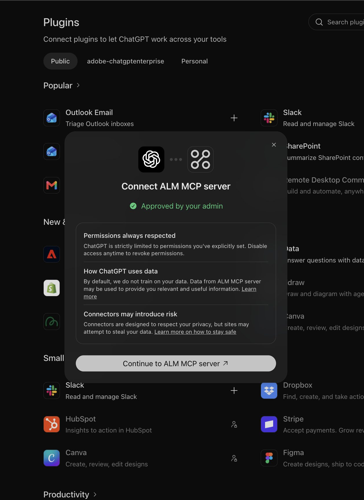

# Configurar el servidor Adobe Learning Manager MCP

## Información general

La configuración consta de dos pasos. Primero, cree un servidor MCP en Adobe Learning Manager. En segundo lugar, conecta el servidor a tu asistente de IA. Después, los alumnos se autentican con Adobe Learning Manager desde el asistente de IA y pueden utilizar las herramientas de MCP.

## Requisitos

* El servidor MCP está habilitado para su cuenta de Learning Manager. Póngase en contacto con el administrador de éxito de clientes o con el servicio de asistencia al Adobe de Adobe para activarlo. Hasta entonces, cada solicitud devuelve 403 Prohibido.
* El servidor MCP es una característica de indicador de backend que solo está disponible para las cuentas **Ultimate tier**.
* El administrador de su asistente de IA tiene permiso para agregar y configurar conectores en esa plataforma.

## Cómo funciona

Un cliente MCP, como Claude o ChatGPT, envía solicitudes a la dirección URL del servidor MCP junto con el token de acceso de OAuth del alumno. Cada herramienta se ejecuta con los permisos del alumno que representa el distintivo. Por lo tanto, un alumno puede hacer a través del servidor MCP solo lo que ya puede hacer en Adobe Learning Manager.

El servidor utiliza el flujo de código de autorización de OAuth 2.0. El asistente de inteligencia artificial se autentica como cliente confidencial con el ID de cliente y el secreto de cliente de una aplicación de Adobe Learning Manager. El servidor no es compatible con el registro de cliente dinámico de OAuth.

## Crear un servidor MCP en Learning Manager

La creación de un servidor MCP configura una aplicación OAuth y le proporciona la dirección URL del servidor MCP, el ID de cliente y el secreto de cliente.

1. Inicie sesión en Learning Manager como administrador de integración.
2. En el menú de navegación, seleccione **Servidores MCP**.
3. En la esquina superior derecha, seleccione **Crear**.

   

4. En la página **Detalles de la aplicación**, escriba lo siguiente y, a continuación, seleccione **Siguiente**:

   * **Nombre de la aplicación:** Escriba hasta 50 caracteres, por ejemplo, ALM para Claude. Los alumnos ven este nombre cuando autorizan la conexión, por lo que debe elegir un nombre que reconozcan.
   * **Dominios de redirección:** Especifique el dominio de devolución de llamada de cada asistente de IA, un dominio por línea. Comience cada uno con y no incluya un trazado. Este campo es obligatorio.
   * **Descripción:** Escriba hasta 150 caracteres; por ejemplo, permite a los alumnos usar ALM de Claude.

5. En la página **Configuración de herramientas**, revise las herramientas y las descripciones que los asistentes de inteligencia artificial utilizan para decidir cuándo llamar a cada herramienta. Para cambiar una descripción, seleccione **Acciones** (**...**) > **Editar**. Para restaurar el valor predeterminado, seleccione **Restablecer**. A continuación, seleccione **Siguiente**.
6. En la página **Credenciales de cliente**, copie la **URL del servidor MCP**, el **ID de cliente** y el **Secreto de cliente**. Guárdelos de forma segura. Las necesitas para conectar tu asistente de IA.

El servidor MCP siempre tiene ámbito Alumno, por lo que no hay ámbitos que seleccionar.

Registre el dominio para cada asistente de IA que piense conectar.

| **Asistente de inteligencia artificial** | **Redirigir dominio para registrar** | **URL de devolución de llamada completa (referencia)** |
|----|----|----|
| Claude | [https://claude.ai](https://claude.ai/) y [https://claude.com](https://claude.com/) | <https://claude.ai/api/mcp/auth_callback> |
| ChatGPT | [https://chatgpt.com](https://chatgpt.com/) | <https://chatgpt.com/connector/oauth/&lt;id>\> (ChatGPT muestra el ID durante la instalación) |

>[!IMPORTANT]
>
>Registre dominios exactos, como [https://chatgpt.com](https://chatgpt.com/). No utilice comodines parciales como [https://*chatgpt.com*](https://chatgpt.com)*, porque pueden coincidir con dominios no relacionados. Para permitir subdominios, use un comodín de etiqueta completa como* [*https://*.example.com](https://encoded-592c9deb-987b-4562-aa3c-9fa3d37d83e9.uri/https%3a%2f%2f.example.com).

Un servidor MCP puede servir a varios asistentes de IA si enumera todos sus dominios de redirección. Para revocar el acceso de un asistente sin que afecte a los demás, cree un servidor MCP independiente para cada uno. Todos los servidores utilizan la misma dirección URL del servidor MCP.

Sólo necesita la dirección URL del servidor MCP. Claude y ChatGPT descubren automáticamente los puntos finales de OAuth de Learning Manager. Para la configuración manual, vea los [puntos finales de OAuth para el servidor MCP de Learning Manager](#oauth-endpoints-reference).

## Conectar su cliente MCP

El administrador de su asistente de inteligencia artificial conecta el servidor MCP. Las interfaces de cliente cambian con frecuencia. Si estos pasos ya no coinciden, consulte la documentación del cliente.

>[!NOTE]
>
>El cliente de IA reestructura y da formato a las respuestas que devuelve la herramienta answer_learning_content_question, de modo que el nivel de detalle de las respuestas puede variar según el cliente.

Antes de comenzar, confirme que el servidor MCP está habilitado para su cuenta y que tiene la dirección URL del servidor MCP, el ID de cliente y el secreto de cliente de la sección anterior.

### Conectar Claude Pro o Max

**Nota:** Los clientes reformulan y formatean el contenido de las respuestas a las preguntas planteadas cuando las respuestas de la herramienta answer_learning_content_question.

1. En Claude, vaya a **Personalizar** \> **Conectores**.
2. Seleccione **Agregar** (+) y, a continuación, seleccione **Agregar conector personalizado**.
3. Indique los detalles del conector y, a continuación, seleccione **Continuar**:

   1. **Nombre:** Escriba un nombre que los alumnos reconozcan, por ejemplo, Adobe Learning Manager.
   2. **URL del servidor MCP remoto:** Escriba la URL del servidor MCP desde la página Credenciales de cliente, con el formato [https://\[alm-host\]/v1/mcp](https://[alm-host]/v1/mcp).

4. En **Autenticación**, mantenga **Iniciar sesión ahora**. Claude lee la configuración de OAuth de Learning Manager y marca las opciones coincidentes como *Detectado*.
5. En **cliente OAuth**, seleccione **Usar su propio cliente OAuth**. Pegue el **ID de cliente** y el **Secreto de cliente**.
6. Seleccione **Agregar**. Claude abre la página de inicio de sesión de Learning Manager. Después de iniciar sesión, el conector se muestra como conectado.

>[!NOTE]
>
>Claude etiqueta el campo Secreto de cliente como opcional, pero Learning Manager lo requiere. Si lo deja vacío o introduce un valor incorrecto, el inicio de sesión falla y aparece el mensaje &quot;Error de autorización&quot;.

### Connect Claude Team o Enterprise

Solo el propietario de una organización o un miembro con una función que pueda administrar conectores pueden agregar el conector. Los miembros nunca ven el ID o el secreto de cliente.

>[!NOTE]
>
>Los clientes reformulan y dan formato a la verbosidad de las respuestas a las preguntas planteadas cuando cambian las respuestas de la herramienta answer_learning_content_question.

1. En Claude, inicie sesión como propietario de una organización o miembro con permiso para administrar conectores.
2. Vaya a **Configuración de la organización** \> **Conectores**.
3. Seleccione **Agregar**, pase el puntero sobre **Personalizar** y, a continuación, seleccione **Web**.
4. Escriba el nombre y la dirección URL del servidor MCP y, a continuación, establezca **Autenticación** y **cliente OAuth** como se describe en los pasos 4 y 5 del procedimiento anterior.
5. Seleccione **Agregar**.

El conector ya está disponible para su organización. Cada miembro selecciona **Connect** e inicia sesión en Learning Manager con su propia cuenta.

### Conectar ChatGPT Team o Enterprise

>[!NOTE]
>
>Los clientes reformulan y dan formato a la verbosidad de las respuestas a las preguntas planteadas cuando cambian las respuestas de la herramienta answer_learning_content_question.

1. Inicie sesión en ChatGPT como propietario o administrador del espacio de trabajo.
2. En la barra lateral izquierda, haga clic en **Complementos**.
3. Haga clic en **Agregar** en la esquina superior derecha y seleccione **Crear aplicación MCP**.
4. En la ventana **Nuevo complemento**, configure la conexión:

   * **Nombre:** Adobe Learning Manager, o el nombre por el que tus alumnos conocen tu plataforma de aprendizaje.
   * **Conexión:** mantenga **URL de servidor** seleccionada e introduzca [https://\[alm-host\]/v1/mcp](https://[alm-host]/v1/mcp)
   * **Autenticación:** OAuth

   

5. Haga clic en **Configuración avanzada de OAuth**. ChatGPT descubre los puntos finales de ALM OAuth automáticamente.
6. En **Registro de cliente**, mantenga **Método de registro** establecido en **Cliente OAuth definido por el usuario** y, a continuación, introduzca el **ID de cliente OAuth** y el **secreto de cliente OAuth** en el paso 1.
7. Compruebe la **URL de devolución de llamada** que se muestra en este panel. Su dominio (<https://chatgpt.com>) debe estar en **Dominios de redirección** del servidor MCP desde el paso 1.

   

       **Los extremos se detectan automáticamente**
   
   Normalmente no es necesario cambiar los puntos finales de OAuth. Si ChatGPT se lo pide, utilice: Dirección URL de autenticación [https://\[alm-host\]/oauth/o/authorised](https://[alm-host]/oauth/o/authorised), dirección URL de token [https://\[alm-host\]/oauth/token](https://[alm-host]/oauth/token), dirección URL de registro vacía, recurso [https://\[alm-host\]/v1/mcp](https://[alm-host]/v1/mcp), alumno de ámbito:write.

8. Selecciona **Entiendo y quiero continuar**, luego haz clic en **Crear**.
9. En la ventana **Conectar**, haz clic en **Continuar** e inicia sesión en ALM. La ventana debe mostrar *Aprobado por el administrador*.
10. Ponga el complemento a disposición de los usuarios de destino en su espacio de trabajo.

    

## Autenticación de usuario final

Una vez que el administrador complete la configuración, los alumnos añaden el conector de Adobe Learning Manager de la lista de conectores de su asistente de IA y seleccionan Conectar. Se abrirá la página de inicio de sesión de Adobe Learning Manager. Después de que el alumno inicie sesión (mediante SSO, si la cuenta lo utiliza) y apruebe el acceso, el asistente de IA se vincula a la cuenta de Adobe Learning Manager del alumno.

>[!NOTE]
>
>Si el navegador ya tiene una sesión de Adobe Learning Manager activa, el asistente se conecta a ese usuario sin solicitar las credenciales. Para conectarse como otro usuario, cierre sesión primero en Adobe Learning Manager o utilice una ventana privada del navegador.

La autenticación es un paso que se realiza una sola vez. Si se revoca el acceso de un alumno o caduca su sesión, el asistente le solicitará que inicie sesión de nuevo.

## Girar el secreto de cliente o revocar el acceso

No se puede regenerar un secreto de cliente. Para rotarla:

1. Cree un nuevo servidor MCP, como se describe anteriormente en este artículo.
2. Actualice el asistente de inteligencia artificial con el nuevo ID de cliente y el secreto de cliente.
3. En **Administrador de integración** > **Servidores MCP**, seleccione **Acciones** (**...**) > **Eliminar** para el servidor antiguo.

Los alumnos deben volver a iniciar sesión después de cambiar.

Para desconectar un asistente de IA para todos los alumnos, elimine su servidor MCP de la misma página.

## Herramientas disponibles

El servidor MCP expone las siguientes herramientas. Todos se ejecutan con los permisos del alumno que ha iniciado sesión.

<table>
<colgroup>
<col style="width: 46%" />
<col style="width: 31%" />
<col style="width: 21%" />
</colgroup>
<thead>
<tr>
<th><strong>Herramienta</strong></th>
<th><strong>Qué hace</strong></th>
<th><strong>Mensajes de ejemplo</strong></th>
</tr>
</thead>
<tbody>
<tr>
<td>search_learning_items</td>
<td>Busca cursos, rutas de aprendizaje, certificaciones, ayudas de trabajo, insignias, aptitudes, catálogos y etiquetas en el catálogo. Filtros: tipo, estado del alumno, aptitud, etiqueta, catálogo, formato de entrega, precio e idioma. Devuelve hasta 10 resultados por página.</td>
<td>"Cursos de Python para principiantes" 
"Cursos de formación en francés gratuitos"</td>
</tr>
<tr>
<td>list_my_learning_enrollments</td>
<td>Muestra el aprendizaje inscrito, en curso y completado del alumno, con el estado, el progreso y la fecha límite. La última vez que se inscribió primero de forma predeterminada.</td>
<td>"¿En qué estoy inscrito?" 
"¿Qué hay que hacer pronto?" 
"Mis cursos de formación completados"</td>
</tr>
<tr>
<td>get_learning_object</td>
<td>Obtiene todos los detalles de un curso, una ruta de aprendizaje, una certificación o una ayuda de trabajo por ID, incluidas opcionalmente instancias, aptitudes y subelementos.</td>
<td>"Cuéntame más sobre el segundo plato"</td>
</tr>
<tr>
<td>get_my_learning_profile</td>
<td>Obtiene el perfil de ALM del alumno, incluidos el responsable y la cuenta.</td>
<td>"¿Quién es mi gerente en ALM?"</td>
</tr>
<tr>
<td>answer_learning_content_question</td>
<td>Responde a preguntas sobre la materia del curso mediante el Asistente de aprendizaje de ALM, basado en el contenido del curso con citas. Devuelve un identificador de conversación que el asistente utiliza para las preguntas de seguimiento.</td>
<td>"Explicar TCP frente a UDP como se describe en mi curso de redes"</td>
</tr>
<tr>
<td>personalized_learning_path</td>
<td>Proporciona rutas de aprendizaje personalizadas en Adobe Learning Manager adaptadas a los objetivos, temas y necesidades de aprendizaje de un alumno. Permite generar recomendaciones de cursos, guardar una ruta de aprendizaje seleccionada en la cuenta del alumno, enumerar las rutas de aprendizaje guardadas del alumno (lista de acciones) y obtener los detalles y cursos de una ruta de aprendizaje guardada mediante su ID (detalles de la acción). Ayuda a los alumnos a identificar contenido de aprendizaje relevante para desarrollar habilidades y alcanzar objetivos de aprendizaje.</td>
<td>"Guarde la ruta de aprendizaje seleccionada en mi cuenta".</td>
</tr>
</tbody>
</table>

Las conversaciones iniciadas mediante answer_learning_content_question aparecen en el informe Conversaciones de IA del alumno, al igual que las conversaciones del Asistente de aprendizaje de ALM.

## Límites

| **Límite** | **Valor** |
|----|----|
| Resultados por página (búsqueda e inscripciones) | Hasta 10. Utilice el cursor devuelto para obtener más páginas. |
| answer_learning_content_question rate | 10 solicitudes por minuto por alumno (ráfaga de 5), con un máximo de 2 en curso a la vez |
| Versiones de protocolo MCP compatibles | 2025-11-25, 2025-06-18, 2025-03-26 |
| Transporte | HTTP streaming, sin estado (solo POST; sin flujo de eventos enviado por el servidor) |

## Referencia de puntos finales de OAuth {#oauth-endpoints-reference}

Claude y ChatGPT los descubren automáticamente. Se enumeran aquí para los clientes o proxies que los necesitan introducidos a mano. Reemplace `alm-host` por el host de la dirección URL del servidor MCP (su host de región o dominio personalizado ALM).

| **Valor** | **URL** |
|----|----|
| URL del servidor MCP | [https://\[alm-host\]/v1/mcp](https://[alm-host]/v1/mcp) |
| URL de autorización | [https://\[alm-host\]/oauth/o/authorised](https://[alm-host]/oauth/o/authorised) |
| URL de token | [https://\[alm-host\]/oauth/token](https://[alm-host]/oauth/token) |
| Actualizar URL | [https://\[alm-host\]/oauth/token/refresh](https://[alm-host]/oauth/token/refresh) |
| Base del servidor de autorización | [https://\[alm-host\]](https://[alm-host]) |
| Recurso | [https://\[alm-host\]/v1/mcp](https://[alm-host]/v1/mcp) |
| Ámbito | alumno:write |

## Resolución de problemas

| **Síntoma** | **Causa y corrección** |
|----|----|
| Redirección no registrada durante el inicio de sesión | El dominio de devolución de llamada del asistente de inteligencia artificial no está en **Dominios de redirección** de la aplicación. Agréguelo (por ejemplo, <https://claude.ai>) e inténtelo de nuevo. |
| El inicio de sesión se realiza correctamente y el asistente indica que la autorización ha fallado (cliente no válido) | El secreto de cliente especificado en el asistente no coincide con la aplicación. Copie de nuevo desde ALM, compruebe si hay espacios adicionales y vuelva a conectar. |
| Todas las solicitudes devuelven 403 Prohibido | El servidor MCP no está habilitado para su cuenta. Póngase en contacto con Asistencia al Adobe. |
| Conectado como el usuario de ALM incorrecto | El navegador ya tenía una sesión de ALM. Desconectar, cerrar sesión de ALM (o utilizar una ventana privada) y volver a conectar. |
| &quot;Se ha superado el límite de velocidad&quot; de la herramienta de preguntas y respuestas | El alumno ha superado el límite de velocidad de preguntas y respuestas. Espere un minuto e inténtelo de nuevo. |
| El asistente solicita iniciar sesión de nuevo | El token del alumno expiró o se revocó. Vuelva a hacer clic en **Conectar**. |

## Preguntas más frecuentes

**¿Pueden los alumnos usar el servidor MCP sin que un administrador lo haya configurado?**
No. Un administrador de integración debe crear un servidor MCP en Adobe Learning Manager (paso 1), ya que el servidor MCP no admite el registro de clientes dinámicos.

**¿Podemos usar nuestro propio dominio?**
Sí. Si su cuenta de Adobe Learning Manager tiene un dominio personalizado, úselo en lugar de `alm-host` en todas las direcciones URL.

**¿Qué funciones de ALM pueden utilizar el servidor MCP?**
Cualquier usuario de Adobe Learning Manager puede conectarse. Las herramientas actúan en el contexto del alumno, y las comprobaciones de permisos propios de ALM se aplican a cada solicitud.
