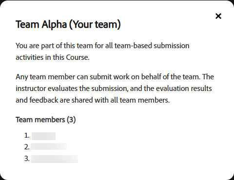

# Enviar una tarea como equipo en Adobe Learning Manager

Visualiza a tu equipo, trabaja juntos en la tarea, carga un archivo para todo el equipo y comprueba el resultado de la evaluación de tu equipo.

Cuando se le asigne a un equipo, recibirá una notificación.

En un módulo de envío de archivos basado en el equipo, cualquier miembro del equipo puede cargar el archivo para todos los miembros del mismo equipo que ellos. El instructor evalúa el trabajo una vez y el resultado se aplica a todo el equipo.

## Ver el equipo y el plan de evaluación

1. Abra el curso en la aplicación del alumno y, a continuación, vaya a la página de información general del curso. Las actividades de equipo se marcan como actividades de equipo en el esquema del curso.

   

1. Seleccione **Ver miembros del equipo** para ver una lista de otros alumnos que están en el mismo equipo que usted.

   

1. Si aún no está en un equipo, un mensaje le indicará que la actividad comienza después de que se le haya asignado a un equipo. Póngase en contacto con el instructor o el administrador.

1. Si el autor lo permite, vea en qué se le evaluará. Puede leer la descripción del plan de evaluación y la descripción de cada parámetro de evaluación. No puede ver las opciones de respuesta, los puntos ni el grosor.

Recibirá una notificación y un correo electrónico cuando se le agregue a un equipo, se le elimine de un equipo o se agregue o quite un miembro del equipo.

## Enviar el archivo del equipo

1. En la página de descripción general del curso, abra la actividad basada en el equipo.

1. Pon de acuerdo con tu equipo sobre el archivo que debes enviar. Seleccione **Cargar**.

   

1. Cargue el archivo. El estado cambia a **Evaluación pendiente**. Sin embargo, puede revisar su envío y enviar un archivo diferente.

   

Se notifica al instructor. Cada miembro del equipo puede ver el estado y el archivo enviado, y descargarlo. Todos los miembros del equipo reciben una notificación y un correo electrónico cuando un miembro envía o vuelve a enviar.

Para reemplazar el archivo antes de aprobarlo, seleccione **Ver**/**Enviar cambios** y, a continuación, cargue un nuevo archivo.

>[!NOTE]
>
>Si el autor no necesita la aprobación del revisor, la actividad se completa para todos los integrantes del equipo en cuanto se envía el archivo.

## Ver el resultado

1. Abra la actividad basada en equipo después de que el instructor la evalúe. Todos los miembros del equipo reciben una notificación.

1. Ver el estado, como aprobado o rechazado.

1. Lea los comentarios del instructor si el instructor eligió mostrarlos.

1. Si la actividad tiene un plan de evaluación, consulte el nombre del revisor, la opción seleccionada para cada parámetro de evaluación, las respuestas escritas y cualquier comentario. No se muestran los puntos de las opciones individuales.

1. Si la puntuación está activada, consulta la puntuación general de tu equipo.

Si la actividad no requiere aprobación, verá que se evalúa, con el resultado.

## Volver a enviar tras un rechazo

Si el envío de su equipo fue rechazado, lea los comentarios y, a continuación, cargue un nuevo archivo. El nuevo archivo reemplaza al anterior.

## Resolución de problemas

**La actividad indica que debes estar asignado a un equipo.** Aún no estás en un equipo. Póngase en contacto con el instructor.

**No se puede cambiar a otra instancia.** No se pueden cambiar instancias después de que el equipo realice el envío. El cambio solo se permite mientras el equipo esté desbloqueado.

**El envío desapareció y el estado indica que está pendiente de envío.** El instructor no lo envió y recibió una notificación y un correo electrónico. Vuelva a cargar el archivo. No se ven el envío o los comentarios anteriores.
